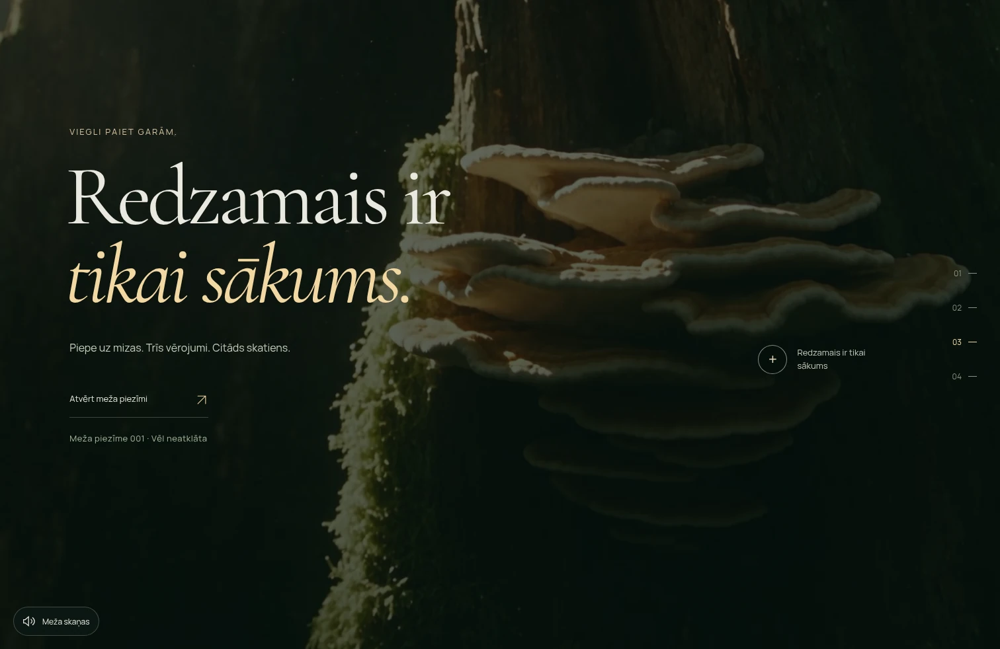
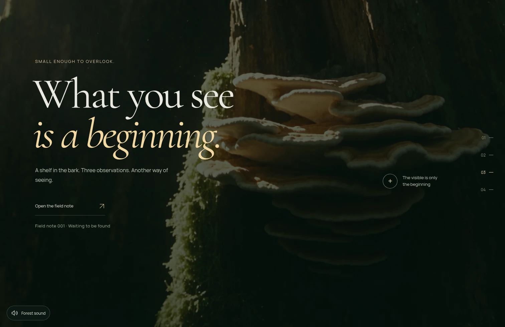
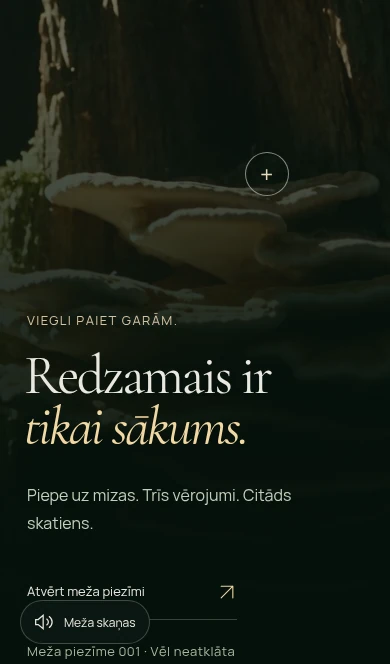
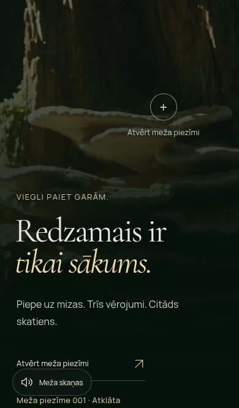
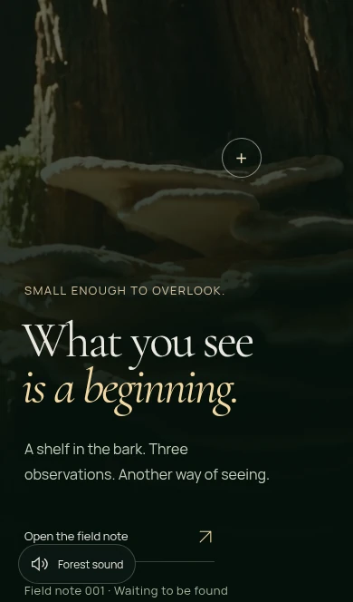
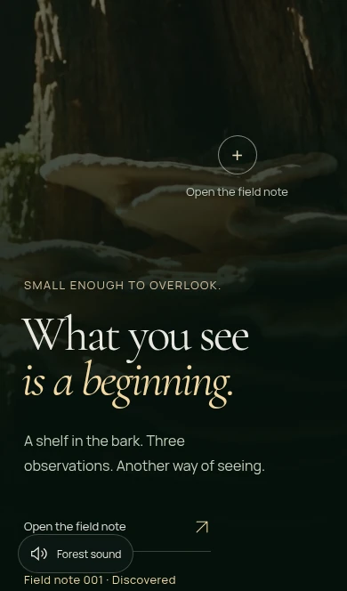

# PIE.PE 2.4 — audit and review evidence

Base: `4ca999676e2b7e79761ff779c964043b5514dc06`, freshly fetched `main`. Development: `codex/piepe-v24`. The complete local Issue #8 specification matches the GitHub issue. **PR review only: do not merge or deploy.** Production remains 2.3.

## Audit before implementation

| Classification | Finding and evidence | Decision |
| --- | --- | --- |
| Confirmed bug | `App.tsx` updates `collected` only on download; `Story.tsx` uses it for the unseen caption. All ten LV/EN viewport checks still show unseen after opening/closing the note. | Distinguish unseen, discovered and collected; restore safe session progress. |
| Confirmed mobile gap | `style.css` hides the specimen invitation caption at <=1100px. Its accessible name promises an encounter while the action opens the existing note. | Make the existing action explicit and visible, preserving the mobile plus anchor. |
| Already correct | Eleven rendered images per locale: two informative wallpaper previews have localized alt; five scenic/monitor/note images are hidden/redundant; logo images obtain functional link names. Film/poster/canvas layers are under `aria-hidden`. | Keep deliberate empty alt and the quiet scenery tree. |
| Already correct | Initial reduced motion/save-data request no films. Reactive reduced-motion switching reduce→normal→reduce→normal produces 0→1→0→1 environmental video elements. | Preserve the existing hook, static alternatives and camera implementation. |
| Confirmed preference gap | Explicit Replay requests an MP4 under both static preferences; the footer offers Pause when motion is disabled. A simulated Network Information change to save-data leaves a film playing. | Guard/hide inapplicable replay/motion controls; listen for supported data-preference changes. |
| Confirmed first-paint gap | Holding the application bundle with reduced motion/save-data leaves the pre-rendered title invisible and offers an inactive Pause control. | Show the existing static title before hydration; hide motion controls until applicable. Normal opening-film typography stays intact. |
| Confirmed control gap | After media error then Escape, Retry is offered while globally paused; clicking it merely changes the label to Resume with zero videos. | Give explicit paused state priority over Retry. |
| Already correct | Generated OG/Twitter large-preview metadata, localized titles/descriptions, canonical/hreflang, schema and sitemap are present. | Preserve existing tags; add the missing localized Twitter image alt only. |
| Optional editorial improvement | The current glossary is already concise and accurate. | Add two optional sentences inside its existing disclosure, relating visible size to hidden hyphae and pore features to identification. No second disclosure or invented imagery. |

## Implementation

- `App.tsx` restores monotonic `unseen` / `discovered` / `collected` progress using existing safe session conventions. The existing camera's `onDocked` callback marks a successfully readable note; cancelling film preparation does not. Explicit download alone collects it. Legacy `piepe-note-found` sessions still restore as collected. When storage is denied, progress survives within the mounted page, including LV/EN/history, but cannot survive a reload; no tracking/storage workaround was added.
- `Story.tsx` announces localized progress politely. The specimen invitation says the same action as the existing note button, including its accessible name. On portrait phones the small caption sits below the original 44px plus anchor; it does not move that photographic target or promise the separate 3.0 portal.
- Two species-agnostic sentences inside the existing optional glossary explain hidden hyphae extent and identification features. The existing native disclosure and its keyboard semantics remain; poetic observations are unchanged.
- Replay respects static preferences, supported connection preference changes suspend/restore environmental playback, and explicit pause takes precedence over error Retry. The existing reactive reduced-motion hook and all film/camera timelines remain intact.
- Added one localized `twitter:image:alt`, including client-side locale updates. Existing OG/card/canonical/hreflang/schema/security behavior remains intact.

## Actual browser review: before / after

Chromium, local production build through the existing Worker-equivalent preview (`127.0.0.1:4173`). Each pair shows the same encounter position **after opening and closing the note without downloading**. Before: falsely unseen, ambiguous invitation / hidden phone caption. After: discovered, explicit localized note action. Evidence WebP copies are compressed screenshots only; product assets are untouched.

| View | Before (2.3) | After (2.4) |
| --- | --- | --- |
| LV · 1512×982 |  |  |
| EN · 1512×982 |  |  |
| LV · 390×664 |  |  |
| EN · 390×664 |  |  |

Both languages were also rendered at **390×844, 320×690 and 844×390**. The invitation caption stays visible/in bounds, portrait phones retain the exact original plus position, targets stay at least 44px, and the document has no horizontal overflow. Narrow landscape requires normal scrolling; content is not compressed into a fixed panel. [Ten-view audit geometry/state matrix](qa/v24/audit-matrix.json). Optional glossary: [LV phone](qa/v24/glossary-lv-390x664.webp), [EN phone](qa/v24/glossary-en-390x664.webp).

The visual trade-off is one quiet caption below the portrait-phone plus and a gold discovered caption, using the existing type/palette. At 844×390 the existing inline invitation now includes its caption: the plus sits 125px farther left to make room, remaining on the fungus in the inspected composition ([LV landscape](qa/v24/landscape-lv-844x390.webp), [EN landscape](qa/v24/landscape-en-844x390.webp)). The floating sound toggle retains its existing location and behavior. No additional controls, HUD, structural redesign or cinematic motion changes; no additional capture suite or video encoding was committed. The existing CI scroll comparison does capture deployed 2.3 and local 2.4 at 1440×900 LV: [Chromium artifact](https://github.com/aigars-avotins/piepe/actions/runs/40832227488/artifacts/12879353215), `scroll-recording-*/{before,after}/*.webm`. Key frames at 3/6/10/14 seconds were visually inspected for full-bleed composition and preserved scenery; capture start times differ, so this is not a synchronized pixel comparison.

## Focused development checks

| Check | Result |
| --- | --- |
| TypeScript, ESLint, production build | Passed locally. |
| Worker unit tests | 11 passed, including range/security/media failure handling. |
| New `tests/v24.spec.ts` | 11 passed in Chromium; two static-preference cases rechecked after adding delayed-hydration coverage. Covers both locales, real download, monotonic restoration, denied storage, cancelled awakening, live preference changes, failed-scene resume, mobile invitation/disclosure and metadata. |
| Existing targeted regressions | 20 passed in Chromium. Includes sound permission/mute/retry, focus/close, responsive/cover geometry, native scrolling, real moving frames and repeated visits/loops, and stable photo docking on MacBook/phone. Existing cinematic assertions were not weakened. |
| Targeted axe WCAG 2 A/AA + 2.1 A/AA | **0 violations across 20 states**: LV/EN × five viewports × open note/expanded glossary. [Results and incomplete-rule targets](qa/v24/accessibility.json). |
| Manual accessibility review | Keyboard disclosure, tabs/Home/End, Escape, focus return, localized names and progress inspected. Axe cannot resolve all contrast over photographic/composited backgrounds; new text was visually inspected against actual scenery. The icon-only phone close button retains its existing localized name and hidden × glyph (axe asks for manual label review). This is not a complete screen-reader/WCAG certification. |
| Media preservation | All four delivered video SHA-256 hashes match 2.3 exactly: **30,320,610 bytes**, same resolution/frame rate/quality. [Checksums](qa/v24/media-integrity.json). No changes to source masters, posters, wallpapers, fonts, brand or other production assets. |

No dependencies, re-encoding, loading-quality reductions or CI/workflow changes. The performance work is limited to respecting static preferences; no new Lighthouse benchmark or score improvement is claimed. Actual moving frames/cover/revisits and the no-second-nudge checks remain part of release validation.

## Final candidate validation and limitations

The single complete [manual release-validation run](https://github.com/aigars-avotins/piepe/actions/runs/40832227488) tested source `56fe6724d0d75ea5b29f03ae1fbf2ac236a64a9f`, unfiltered Chromium + native **macOS 15 Intel WebKit**, production smoke **off** because 2.4 is not deployed:

| Browser | Initial result |
| --- | --- |
| Chromium | **100 passed**, 0 failed/skipped/flaky. |
| Native macOS WebKit | **96 passed, 3 failed, 1 skipped** (the Chromium-only CI recorder). |

Diagnosis before the one permitted necessary retry:

- Both existing desktop `v23.spec.ts` frame probes failed: one callback-cadence timeout with advancing native video time, and one sample set with only two distinct pixel hashes. Phone frame/revisit tests, photo docking tests and other media tests passed. These failures are retained as evidence, not treated as a pass; the existing cinematic tests and their cadence/pixel/visibility requirements are unchanged.
- The new live-preference test requested Understory playback after WebKit's native scroll anchoring had moved the viewport to the encounter during the intentionally shorter static layout. The failure screenshot shows the encounter; the clip correctly remained idle offscreen. The test now natively revisits Understory after restoring motion, then still requires media readiness and advancing playback. No forced application scrolling or camera changes were introduced.

The necessary retry will run the complete native WebKit suite once, with unchanged application/media sources and the diagnosed test navigation correction. Chromium already validated the identical application; the changed preference test is also rechecked locally. No further full run is authorized by this task. Final retry results will be recorded before handoff.

- Firefox was downloaded and attempted locally, but failed before opening any page: `browserType.launch … Could not find profile folder`. Moving its temporary profile from `/tmp` into the workspace produced the same launch failure. **No Firefox pass is claimed.**
- Phone sizes and touch behavior are browser emulation, **not physical iPhone testing**. Native macOS WebKit is a separate CI result, not evidence of physical Safari/iOS hardware.
- No Search Console indexing or social-platform cache verification is claimed. Metadata was checked in both generated local Worker responses and after locale changes.
- **No merge, main push, Cloudflare configuration change or production deployment.** Production remains 2.3 pending owner review of this PR.
