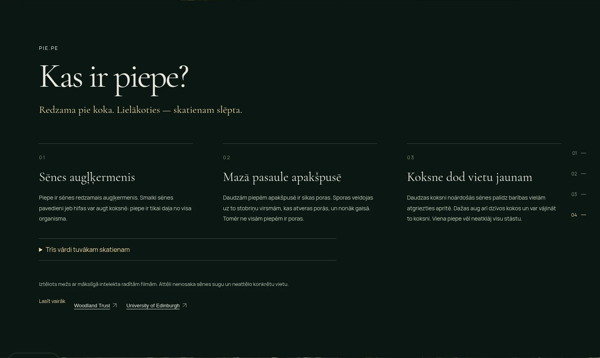
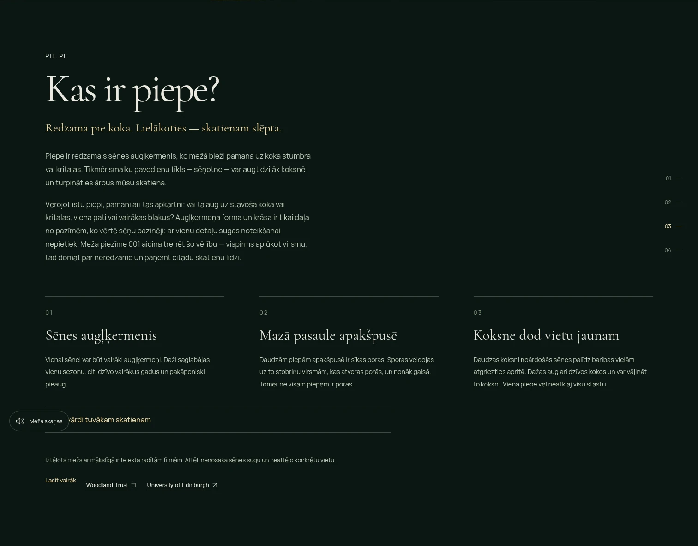
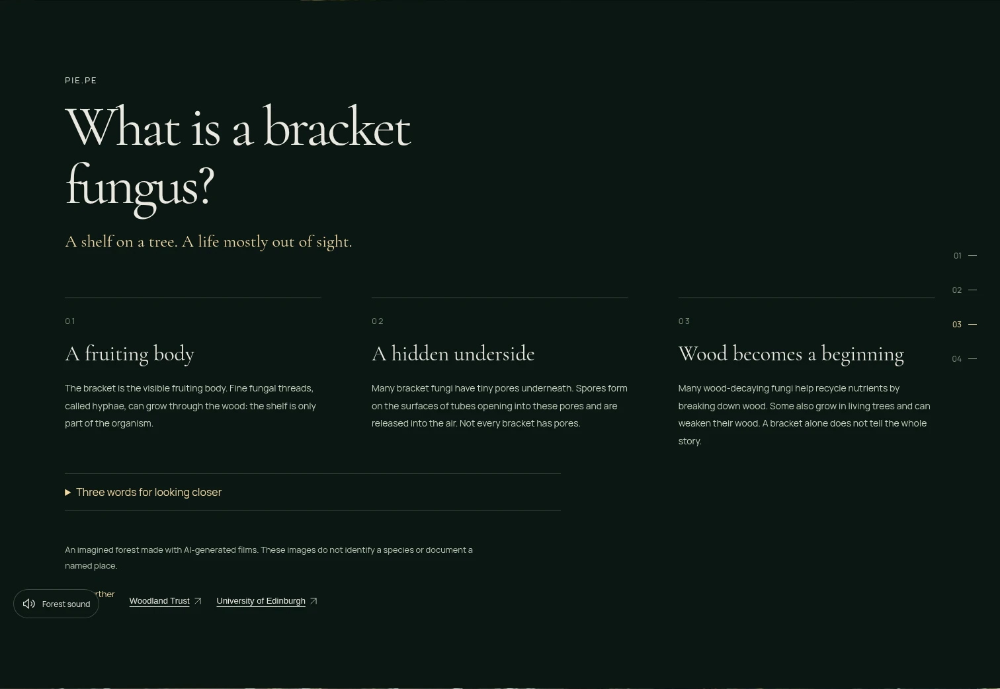
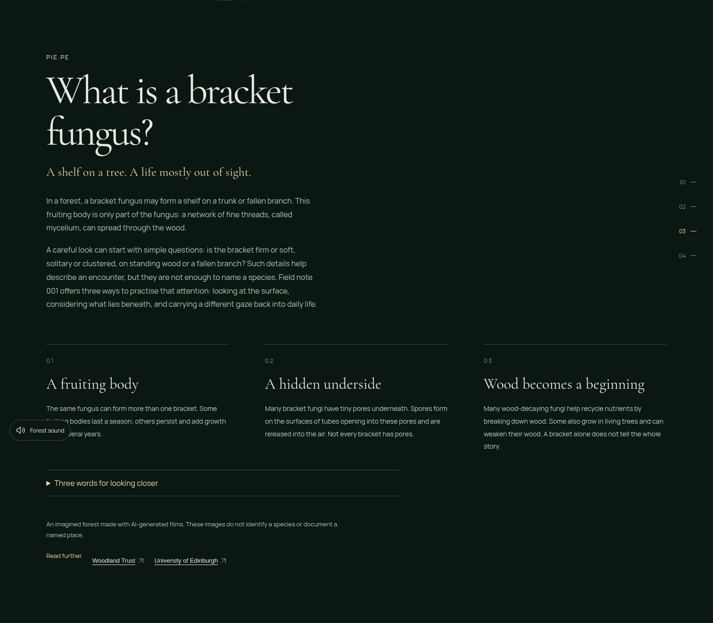
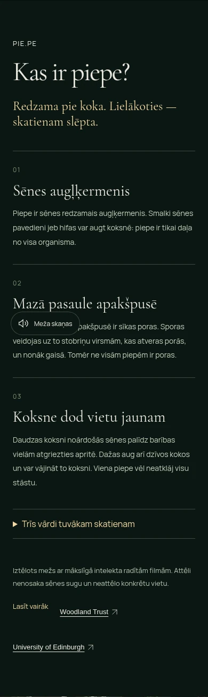
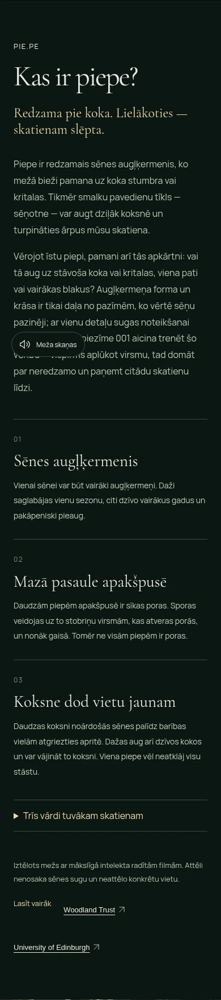
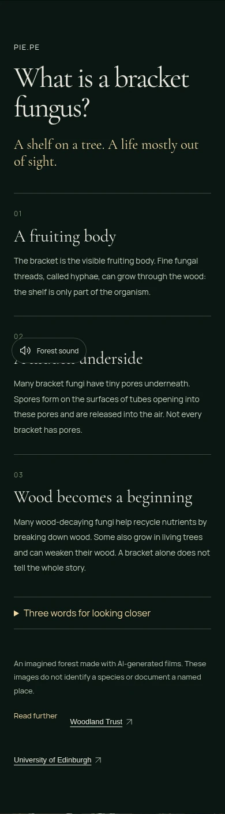
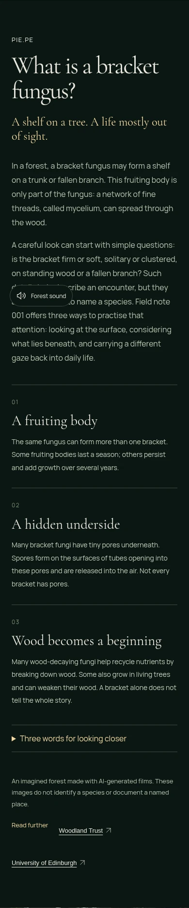

# PIE.PE 2.5 — SEO and content clarity QA

Issue: [#10](https://github.com/aigars-avotins/piepe/issues/10), read in full before changes. Branch: `codex/piepe-v25-seo`, based on freshly fetched `main` at `e9b1f5d46e35e12d7c190335a88ac887321e29de`, after the approved 2.4 release and the owner's Google verification file upload. **PR only; no 2.5 merge or deployment.**

## Audit before implementation

| Area | Observed state | Decision |
| --- | --- | --- |
| Production sitemap | Actual HTTPS 200, `application/xml`, no redirect. Exactly two canonical URLs, reciprocal LV/EN/x-default alternates. Built/public file already exists. | Preserve it. No extra URLs, `priority`, `changefreq`, or build-date `lastmod`. Reliable per-locale significant-content timestamps are not maintained. |
| Production robots | Actual HTTPS 200, `text/plain`, no redirect; wildcard Allow and correct absolute sitemap. | Preserve it. |
| Production pages | `/` is LV and `/en/` EN; both actual HTTPS 200, `text/html`, no redirect, `max-age=0, must-revalidate`, no X-Robots-Tag. Existing crawlable facts, canonical/hreflang, OG/Twitter, one JSON-LD script. | Keep valid head metadata and SSR. |
| Existing educational content | Three accurate cards, optional glossary and AI-art disclosure already exist. First card currently carries the basic fruiting-body definition. | Introduce a readable definition/context in the existing section; make the first card useful without repeating that definition. Preserve poetic hero/notes and existing pore/ecology cautions. |
| Existing JSON-LD | Valid WebPage containing WebSite; locale updates already work. Stable entity IDs, site description and explicit bilingual site language are absent. | Enrich the existing connected structure with stable IDs and bilingual site identity; retain one script and current WebPage shape. No new entity types or rich-result promises. |
| 2.4 state/cinema | Three note states, preference guards, repeatable films and one-clock photo handoff already implemented. | Preserve all behavior and cinematic tests. |
| Owner verification file | Latest main adds `public/google6c447177e1c36779.html`. | Preserve the upload. Its existence does not establish Search Console access or indexing. |

Live HTTP measurements are of **deployed 2.4**, not a claim that the 2.5 candidate has shipped. [Measured statuses, types, redirects, caching, sitemap/robots contents and page metadata](qa/v25/live-http-summary.json). The local preview uses the actual media Worker and static assets; its development cache behavior does not emulate Cloudflare. Generated CSP hashes are checked independently against `dist/_headers`.

## Content and schema changes

Two always-visible paragraphs now introduce the visible fruiting body/hidden mycelium and suggest practical observations, with a natural bridge to Field note 001. They sit inside the existing facts section after its poetic introduction; no new scene or hero overlay. The first card now explains short-lived/perennial fruiting bodies, avoiding a second copy of the opening definition. Existing qualified pore/spore and wood-ecology cards, glossary and AI-art disclosure remain. The educational appendix in both downloaded notes is generated from the same translations; all three poetic observations remain unchanged.

- LV introduction: “Piepe ir redzamais sēnes augļķermenis, ko mežā bieži pamana uz koka stumbra vai kritalas.”
- EN introduction: “In a forest, a bracket fungus may form a shelf on a trunk or fallen branch.”
- Previously, the first card carried the definition and the introduction only said “Redzama pie koka. Lielākoties — skatienam slēpta.” / “A shelf on a tree. A life mostly out of sight.” Those poetic lines remain, followed by readable context rather than being replaced.
- New paragraphs: **86 LV / 103 EN words**; including the revised first card: **103 LV / 126 EN**, within the approved 80–150 range. [Exact copy/counts](qa/v25/content-audit.json).

The existing WebPage shape and single JSON-LD script are preserved. Its `@id` is now the locale's canonical URL + `#webpage`; nested `isPartOf` has the same stable `https://pie.pe/#website` identity in both languages, `name: PIE.PE`, root URL, real default-LV site description and `inLanguage: [lv, en]`. Existing page title/description/locale stay localized. Connected JSON-LD does not require an `@graph` wrapper; retaining the existing structure avoids unnecessary churn and duplicate entities. SSR escaping and the generated CSP remain intact. No Article, FAQ, Organization or SearchAction entities were added.

Reference availability was checked: University of Edinburgh archive **200**, and its text supports perennial growth zones, spores and wood decay; Woodland Trust **403** to this environment, so its availability is not claimed. A 403 is not evidence of a dead link; the existing references are retained without bibliography expansion.

## Rendered before / after

Actual Chromium rendering of production builds through `127.0.0.1:4173`, both locales. The screenshots capture the existing facts section, including its retained floating sound control. WebP copies are QA evidence; no product media were changed.

| View | 2.4 before | 2.5 candidate |
| --- | --- | --- |
| LV · 1512×982 |  |  |
| EN · 1512×982 |  |  |
| LV · 390×664 |  |  |
| EN · 390×664 |  |  |

Also rendered/reviewed at **390×844 and 320×690**, LV and EN. New text uses existing body typography/colors at 16px, 1.8 line height, max 72ch, with two short paragraphs and native scrolling. [Eight-view layout/error/section-height review](qa/v25/responsive-review.json). No horizontal overflow or page errors. The trade-off is a longer reading section before Breathing; camera/film timing and native scene activation code are untouched and rechecked against the shifted section positions. No new animation, controls or cinematic section.

## Focused development verification

| Check | Result |
| --- | --- |
| TypeScript, ESLint, production build | Passed. |
| Worker unit tests | 11 passed. |
| Existing 2.4 state/preferences/control suite + new SEO suite | 18 passed in Chromium; unseen/discovered/collected, storage denial, locale/history/downloads, static/live preferences and scene retry retained. |
| Final copy + cinematic layout spot checks | 10 passed: seven new SEO/content tests plus existing expanded-facts/locale/error navigation, desktop actual frames/loops/three revisits and phone photo stability. |
| New focused tests | Parse real XML assets with DOMParser; check canonical/alternate URLs and robots, no-JS visible copy and word budget, localized note generation, single connected JSON-LD through locale/note changes, generated CSP hashes, readable mobile bounds and unchanged hero. Existing cinematic assertions remain unchanged. |
| Targeted axe WCAG A/AA | 0 violations across eight facts-section views (LV/EN × four sizes). Some color-contrast decisions require manual review; actual text/background/spacing were visually inspected. New paragraph text measures **10.32:1** against the section's opaque background, 16px/28.8px with opacity 1 ([computed styles/contrast](qa/v25/contrast.json)). [Axe results](qa/v25/accessibility.json). This is not full screen-reader certification. |
| Media preservation | All four delivery SHA-256 hashes match 2.4 exactly, **30,320,610 bytes**. [Checksums](qa/v25/media-integrity.json). Source masters, footage/posters, wallpapers, fonts and brand untouched. |

`App.tsx` matches 2.4 apart from its 2.5 version marker; note-state and cinematic controller code is unchanged. No dependencies, Worker/security/domain/build configuration, or sitemap/robots bytes were changed. The owner's verification file remains intact.

## Final validation and limits

The [one complete release-validation run](https://github.com/aigars-avotins/piepe/actions/runs/40860620636) tested `2a59a6bce11dc5218a3d43692692b9e04f47dc25`, with production smoke off because the candidate is not deployed:

| Browser | Full-suite result |
| --- | --- |
| Chromium | **107 passed**, 0 failed/skipped/flaky. |
| Native macOS WebKit | **104 passed, 2 failed, 1 expected skip** (Chromium-only recorder). All seven new SEO/content tests and all eleven existing 2.4 tests passed. |

Both native failures are existing `v23.spec.ts` moving-frame cases: desktop LV and phone EN produced two distinct pixel hashes when the unchanged test requires three. Diagnostics show visible, ready, unpaused films with decoded frame counts; that alone is not substituted for the failed pixel assertion. [Exact failure diagnostics](qa/v25/initial-native-diagnostics.json).

The [single requested focused retry](https://github.com/aigars-avotins/piepe/actions/runs/40862975200), targeting only those two unchanged cases, was **blocked before any job steps or browser tests ran**. GitHub's annotation: “The job was not started because recent account payments have failed or your spending limit needs to be increased. Please check the 'Billing & plans' section in your settings”. No additional run was submitted. This is an account-side execution blocker, not a successful retry or a new TypeScript/lint failure. [Machine-readable validation and blocker](qa/v25/release-validation.json).

**Release validation remains incomplete for those two native cinematic cases.** All new SEO/content cases passed in both browsers, and the 2.4 state/preference cases passed unchanged, but this PR must not be presented as a fully native-validated production release. Completing the focused native verification requires restored Actions billing/capacity. No assertions, media or camera code were changed to obtain a pass. Final follow-up commits contain QA evidence only; the application and tests remain those of the measured candidate.

The separate Cloudflare preview check fails at its Worker-name guard: the branch preview's expected name differs from the preserved `wrangler.jsonc` production name `piepe`. [Exact check/error](qa/v25/preview-check.json). This is not reported as a successful preview deployment. Changing Cloudflare or the production target is outside the authorized 2.5 scope, so the configuration was left untouched. Production was rechecked as **2.4** after pushing this branch.

Phone viewports/touch and preference changes are browser emulation, not physical iPhone testing. Native macOS WebKit results are reported separately when available. Existing 2.4 native frame observations have shown variability; final 2.5 results will be reported without weakening those assertions.

No Search Console login, sitemap submission, Google indexing, search ranking or social-platform cache claim is made. A correct PR and reachable 2.4 baseline do not prove Google has indexed new 2.5 content. Submission/index inspection remains the owner's follow-up after an approved deployment.

**2.5 stays on its feature branch for owner review. No merge to main or Cloudflare deployment.**
