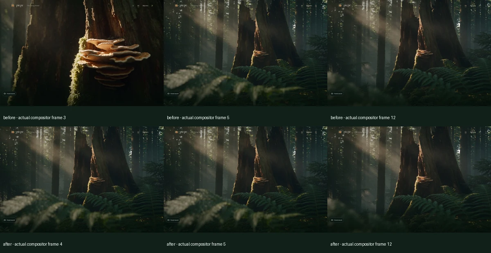
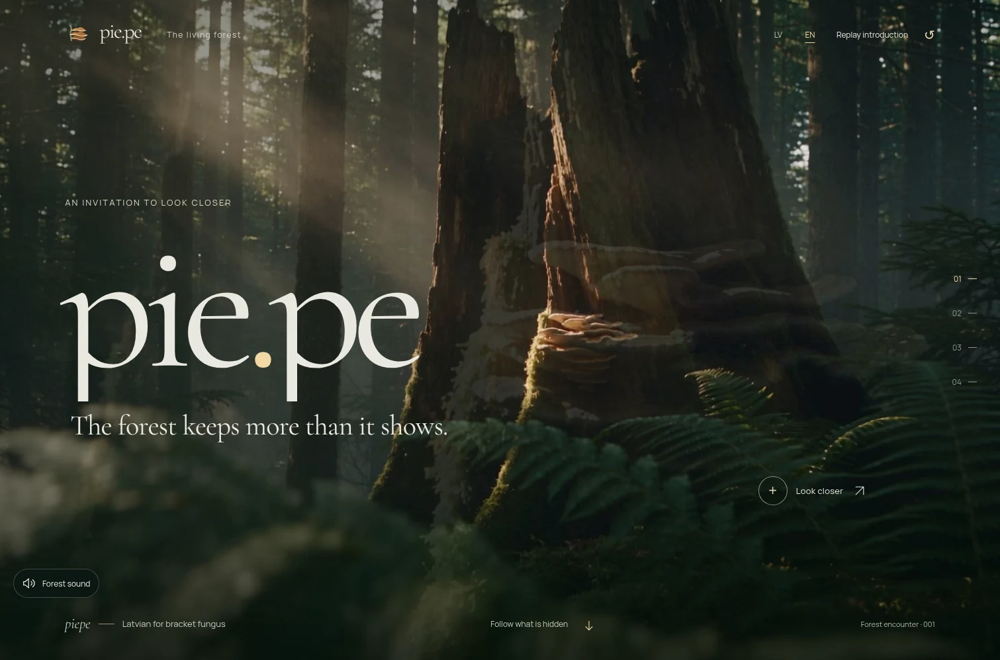
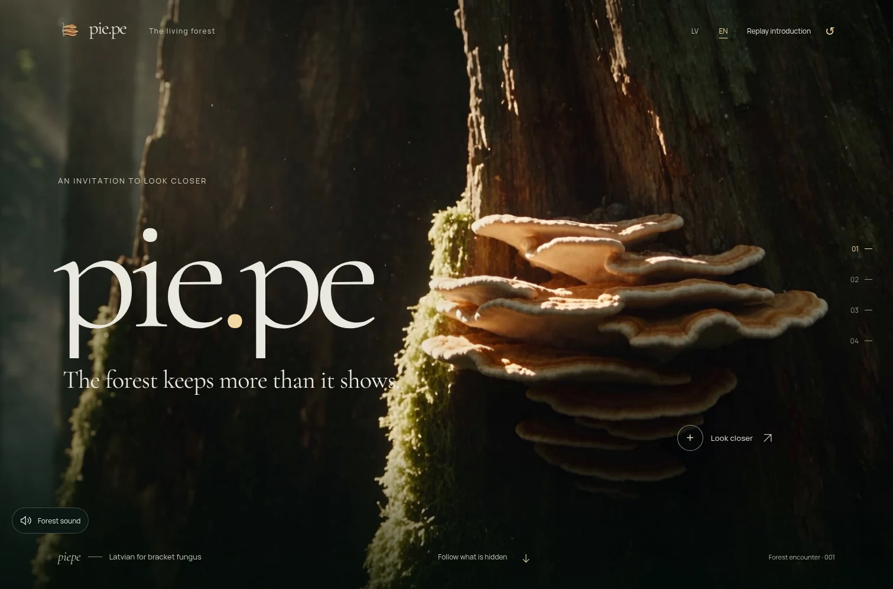
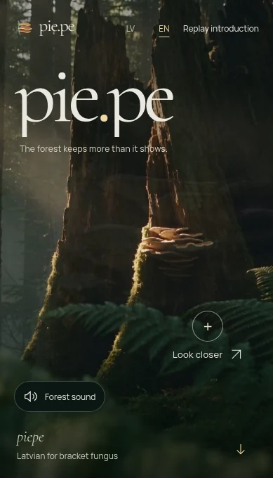
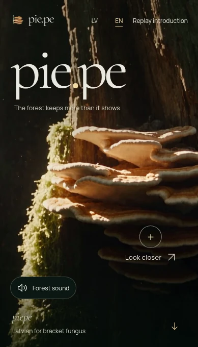

# PIE.PE 2.5.1 — cinematic continuity hotfix

Issue [#12](https://github.com/aigars-avotins/piepe/issues/12) was read in full before changes. Feature branch: `codex/piepe-v251-continuity`, starting at PR [#11](https://github.com/aigars-avotins/piepe/pull/11) head `09144a84822c1283f5dc3272606496afaa432a93`. No 2.5.1 merge or production deployment is authorized.

## Source audit before changes

The initial production audit contradicts the reported 2.5 publication. Both live locales and a cache-busted root return **2.4**, with exact HTML/JS/CSS fingerprints matching the previously validated 2.4 build. Cloudflare reports version `e082f280-277f-44c9-ab43-4a9ee616cc31` at 100%. Its latest successful production build `766917e4-99c4-4803-959f-895537e02c10` used main `e9b1f5d46e35e12d7c190335a88ac887321e29de`. The version API itself does not embed a Git SHA; build metadata plus the independent live fingerprints identify the served code.

| Actual live asset | SHA-256 |
| --- | --- |
| `/` | `6c84ab337dcf35ae5c5f5cea580eb876210a5e26fc65965b0bf404c66234b087` |
| `/en/` | `1e376ea26bef9c50968dc9b2a9f4b9d774325024041d6f0b8662c3c6fd586e75` |
| `/assets/index-DCkYfljr.js` | `f01c9f140cb24e11a4eba687e4a2ceb6292fff148189017d396b9623fed3ef15` |
| `/assets/index-B5D9Obfx.css` | `560d3d969a931bc85ae6bf6d695684df457cf78c3d83e9cf5018d721f501bcbd` |

PR #11 was still open and main still 2.4 when inspected. The hotfix deliberately preserves **all 2.5** changes by starting from #11. The intro, scene, motion hook and boot script are identical between 2.4 and 2.5; only App's version marker differs in these paths. The recordings below use that precise 2.5 production-equivalent cinema code, not an unverified claim of recording deployed 2.5.

During this task the owner separately requested publication of **2.5**. Both remaining native scenarios subsequently passed on unchanged #11 code (phone EN: run 40886217426; desktop LV: run 40887014393). This authorization does **not** include this hotfix. 2.5 was merged with history preserved as `526bd4609c4804afa32fdc31f8daae808d7b759b` and deployed through the existing Worker integration: version `ded86149-a582-45c0-bc97-1f55cbb6bbb7`, 100%. Both live localized HTML responses and JS/CSS match the saved 2.5 build byte-for-byte; sitemap/robots are 200 and security headers remain. The hotfix PR therefore targets **main**, which now includes #11 as an ancestor. No 2.5.1 code was included in that publication.

## Reproduction and causes

**A — cold first visit.** In clean contexts with cold routed requests, holding the opening poster for 1000ms and Reveal response for 1500ms captures the wrong fungus close-up, followed by the correct wide opening. The source of the wrong pixels is `.base-camera .forest-still`: its real source is `forest-final.jpg`; only a `.prerendered` CSS `content` substitution paints the opening. Hydration removes that class before the video poster/first moving frame covers it. Actual Chromium compositor frames 3–4 in the original MacBook capture show the close-up, frame 5 the opening. Paint-by-paint state confirms the substitution changes to `normal` while video readiness remains zero.

**B — reverse after layout refresh.** Three ordinary continuous bottom→top passes without a refresh settled correctly. A same-breakpoint resize while Breathing/ending is visible reliably reproduces the persistent double scene: after returning to zero, `.wide-environment` remains **opacity 1**, above the base plane (z-index 5 vs 1). `.foreground-camera` is zero in this reproduction; the screenshot alone cannot identify which layer is responsible. The stale wide poster/film, plus the returned base forest, produces the composite. `buildCamera()` clears/recreates future `fromTo` tweens with `immediateRender:false`; before their start, those tweens do not restore the values inherited at refresh. Refreshing halfway through the ending transition reproduces the owner's actual translucent duplicate: wide opacity remains **0.875** with scale **1.0225** after bottom→top, visibly superimposing the wide tree over the close-up. Dawn's ending grade can similarly persist. The former independent macro entrance/exit scrubs also wrote the same opacity properties and depended on ordering.

These are lifecycle/ownership bugs, not defective source media. No movie/poster replacement, crop change or arbitrary delayed reset is needed.

## Minimal fixes

- `App.tsx` supplies the **actual opening poster source for the entire intro lifecycle**, including Replay and delayed hydration/decoding. Completion/skip/failure selects the existing held final image once. The existing movie poster and still now agree in the same measured plane. `style.css` substitutes the interactive final pose only for initial no-JS/static-preference visits. No-JS readability, session returns, reduced motion/save-data, existing watchdogs, autoplay handling, title timing and film-finish dissolve are retained; `IntroFilm.tsx` and `boot.js` need no changes.
- `useForestMotion.ts` establishes the complete hero pose at time zero of the camera timeline, including zero wide/foreground/dawn contribution. Refresh and reverse thus resolve to an explicit pose rather than inherited ending styles. A single unsmoothed macro envelope owns Understory and foreground-carrier opacity across both entrance and exit; the camera retains its existing 450ms scrub. Original entrance/exit offsets, durations, easing, chapter geometry, native sticky plateaus, activation and decoder lifecycle remain intact.
- Version markers advance to 2.5.1. No dependencies, security/Worker configuration, media, SEO text/schema/sitemap/robots, note logic, sound permissions or discovery/photo animation change.

## Verification and evidence

The new `tests/v251.spec.ts` records browser video, first-paint screenshots and per-paint source samples, requires real presented intro frames, and checks zero **effective** unwanted layer contribution plus identity base-camera transform. It covers delayed hydration/film, natural completion, cached session return, explicit Replay/skip, empty-session reload, three native bottom/top returns, ending refresh, rapid reversal, return action, header logo, direct fragments, Back/Forward, locale/layout changes, restored reload, landscape and accessible hotspot focus.

Before fixing the build, the cold LV tests failed on both MacBook and phone; the refresh/reverse LV MacBook regression independently failed with a visible ending layer. The first repaired focused run passed both MacBook LV cases. Final matrix, recordings and candidate validation are recorded below.

Phone input is simulated, not physical iPhone testing. Mobile WebKit does not accept Playwright wheel events; its regression uses native keyboard scrolling. Chromium provides wheel and separate touch/inertial evidence. Initial browser blank navigation frames before document/assets arrive are distinguished from a wrong forest image or a black flash between loaded poster and video. No TLS verification is disabled.

### Real before/after captures

Local production builds through the real media Worker, clean Chromium contexts, EN; LV screenshots and recordings are also retained in the cross-browser regression artifacts. These are real browser videos, not rendered reconstructions. MP4/WebP compression applies only to QA evidence, never product media.

| Scenario | Before | After |
| --- | --- | --- |
| Cold MacBook, 1512×982; opening poster delayed 1s, film delayed 1.5s | [Recording](qa/v251/before-cold-desktop.mp4) | [Recording](qa/v251/after-cold-desktop.mp4) |
| Same cold visit, phone 390×664 | [Recording](qa/v251/before-cold-phone.mp4) | [Recording](qa/v251/after-cold-phone.mp4) |
| Ending-transition refresh, bottom→top, MacBook | [Recording](qa/v251/before-ghost-desktop.mp4) | [Recording](qa/v251/after-ghost-desktop.mp4) |
| Same refresh/return, phone | [Recording](qa/v251/before-ghost-phone.mp4) | [Recording](qa/v251/after-ghost-phone.mp4) |

The refresh recordings align halfway through the ending to reproduce the race, resize **within the same breakpoint**, then use native wheel input to the bottom and back. The actual viewport changes from 1512×982 to 1511×998, or 390×664 to 389×680. Fixed recording dimensions can acquire a thin capture padding during resize; the product scene itself remains full bleed. The separate [touch/inertial recording](qa/v251/touch-returns-phone.mp4) shows three full bottom/top returns at 390×844/389×844, with [measured layer states](qa/v251/touch-results.json): every final top is zero and every unwanted layer is zero.

Changed compositor frames were requested with CDP `everyNthFrame:1`, alongside per-animation-frame state samples. This captures actual dirty frames rather than assuming a fixed 60fps capture rate. I inspected the opening frames individually: before, close-up→wide opening; after, the first forest image is the matching wide poster, continuing into moving video with the same crop. The phone capture independently catches the erroneous close-up at frame 4. The browser's original blank navigation and themed background before the deliberately delayed image arrives are retained in recordings; they are not claimed to be loaded movie frames.

| Returned hero | Before: stale wide layer | After: intended single forest |
| --- | --- | --- |
| MacBook |  |  |
| Phone |  |  |

[Paint/camera evidence](qa/v251/paint-and-camera-evidence.json) distinguishes underlay exposure risk from actual captured pixel frames. Before: 92 desktop / 90 phone intro paint samples expose the wrong underlying source while the decoder is not ready. After: **zero**. After return, the deliberately retained original camera scrub settles in approximately **389ms desktop / 481ms phone**, then remains one coherent scene; before, the wrong wide contribution persists indefinitely (desktop 0.875, phone 0.9485). There is no timeout/reset added by the fix.

Additional cold-cache throttling: **100ms latency, 750,000 bytes/s download**, empty contexts, LV 1440×900 and EN 390×844. All **332 / 318** sampled intro paints retain the opening source; actual screenshots show the correct forest. [Conditions/results](qa/v251/throttled-summary.json). Native macOS recordings/screenshots are supplied by the final CI artifact, not by this Linux executor.

### Focused checks and release candidate

TypeScript, ESLint, production build and **11 Worker unit tests passed**. Across the two focused development batches, all **12 new Chromium cases** passed: four cold-load/Replay tests and eight 3-return scenarios (LV/EN × 1512×982, 1440×900, 390×844, 390×664), including landscape and navigation variants. Initial MacBook EN recording hit the existing 9.5s deadline because screenshot encoding held the deliberately delayed response too long. The test now releases the response before screenshot encoding; it passes with the same strict natural `ended` and presented-frame requirements. No application watchdog or existing assertion was relaxed.

The single complete [release-validation attempt](https://github.com/aigars-avotins/piepe/actions/runs/40888622015), candidate `cc2d8c7b6e2af1522fee239e30c9f1cc8fda437f`, production smoke off:

| Browser | Initial full run | Focused completion / final coverage |
| --- | --- | --- |
| Chromium | **119 passed**, no failed/skipped/flaky tests. | All four cold tests also passed locally after the test-only native synchronization correction. |
| Native macOS 15 Intel WebKit | **104 passed, 5 completed failures, 1 expected recorder skip**; one test interrupted and eight not reached at the **20-minute job limit**. | **14 passed**, no failures/flaky/skips in the single focused run. **118 unique scenarios passed + 1 expected recorder skip across both runs**. |

Diagnosis and the one focused completion:

- Three new cold tests stalled in the *test screenshot* before hydration: WebKit waits for `document.fonts.ready` while the test intentionally holds the module response. This is proven by traces after successful image decode / `.prerendered` checks and before any film mount. The fourth cold test was interrupted at the job limit; reverse tests had not run. The native first paint now remains in the real browser video and per-paint source audit; synchronous screenshot capture follows release of the artificial network gates. Video frame presentation is registered before GPU screenshot readback. No application timeout, opacity, animation or assertion was relaxed.
- Two unchanged existing native probes failed: desktop Awakening docking measured 11.993 CSS pixels over a 2ms observer interval (5.996 px/ms, bound 3); desktop LV Breathing produced four presented callbacks within its cadence window. These are retained failures, not declared harmless. Both **passed unchanged** in the focused run; the exact platform/observer variability remains unproven. Other native photo-stability, environmental replay, preference, note and SEO cases passed the initial run. [Exact initial diagnostics and timeout annotations](qa/v251/initial-native-diagnostics.json).
- [Focused native run](https://github.com/aigars-avotins/piepe/actions/runs/40892702261), source `8f0a495c409e51803fdb03d4155011d7a718cdf0`: **all 12 new tests + the two failed existing tests passed**. Application/public assets and original tests are byte-identical to the full Chromium candidate. This was one focused completion, not a second full suite. [Native videos/screenshots/data artifact](https://github.com/aigars-avotins/piepe/actions/runs/40892702261/artifacts/12907045133).

I reviewed the actual [16 Chromium views](qa/v251/chromium-final-views.webp), [12 native WebKit views](qa/v251/native-final-views.webp), and **every recorded native frame in the first three seconds** of MacBook LV and phone EN (75 frames each at 25fps). [Native frame sheet](qa/v251/native-first-three-seconds.webp): after the initial browser blank/theme, the first forest image is the wide opening; no close-up frame appears. Both native languages/sizes show the same crop at movie handoff; all eight native returned heroes show one coherent composition. Native video navigation/resize padding is capture output, not a product border.

**Final coverage: Chromium 119 passed; native macOS WebKit 118 unique scenarios passed + one expected recorder skip.** The initial native full job itself was cancelled, so this does not claim a one-shot green native full run. [Machine-readable results and source history](qa/v251/release-validation.json). 2.5.1 remains unmerged and unpublished, awaiting visual review.

The separately authorized **2.5** publication is fully verified: [actual production smoke](https://github.com/aigars-avotins/piepe/actions/runs/40888197131) **Chromium 2/2, native macOS WebKit 2/2 passed**. [Source audit and live publication fingerprints](qa/v251/source-audit.json). This is distinct from 2.5.1 candidate validation.

### Preservation and limitations

- All four original high-fidelity delivered films retain their exact SHA-256 hashes and **30,320,610 total bytes**. [Media integrity](qa/v251/media-integrity.json). No source master, still/poster, wallpaper, audio, brand, font or other public asset changes.
- 2.5 educational copy, download text, schema, sitemap/robots and locale formatting are unchanged. So are all 2.4 note states, sound controls, discovery/photo timelines and environmental decoder/replay logic. No CI workflow or dependency changes.
- Native macOS WebKit means the macOS Playwright browser/Apple codecs, not Safari app or physical iPhone certification. Phone wheel/touch/toolbar behavior is simulated. Local HTTPS Chromium has the managed certificate limitation documented in earlier QA; HTTPS production verification uses validating curl and the actual GitHub browser jobs, without disabling TLS.
- Automatic Cloudflare **branch preview** check still fails its pre-existing Worker-name guard: “The name in your wrangler.jsonc file (piepe) must match the name of your Worker.” [Exact check](qa/v251/preview-check.json). Its production build stage succeeds; the branch preview deployment aborts. No configuration rename, new Worker or manual hotfix deployment was performed; the automatic preview attempt aborted at that guard. Production remains the independently published 2.5 version above.
- Current Actions billing/capacity allowed the tests to start. Historical 2.5 billing/observer failures are retained in #11 and its QA; a successful focused retry is not retroactively substituted for the failed history.
