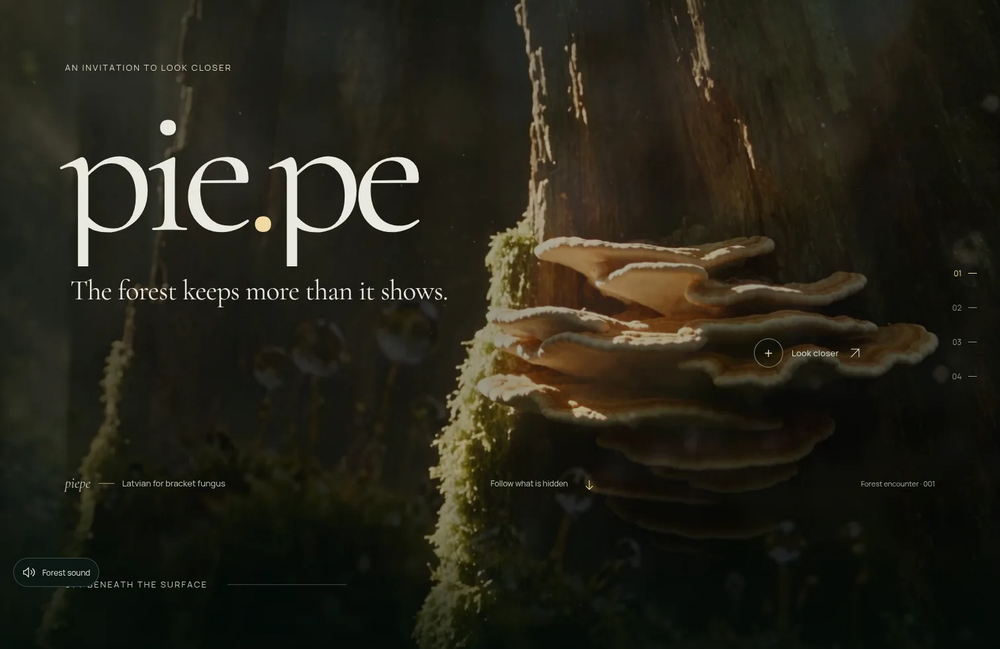
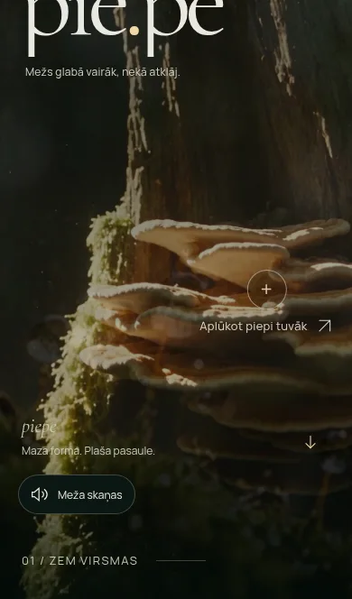
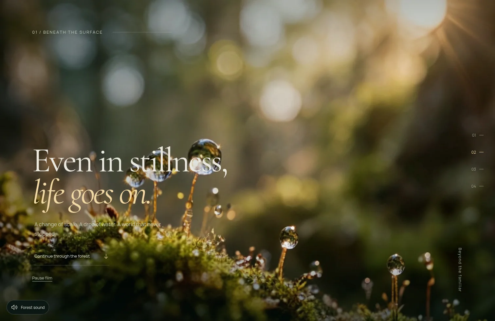
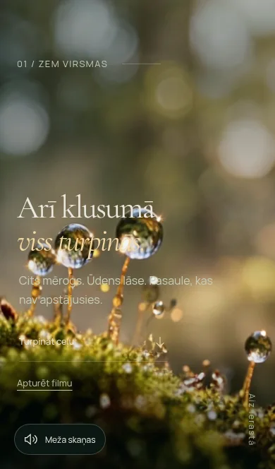
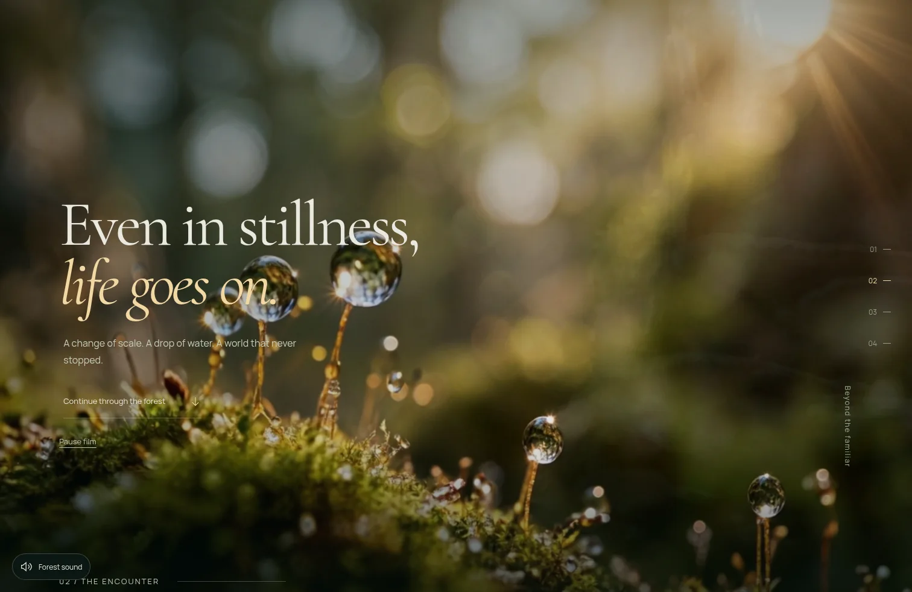
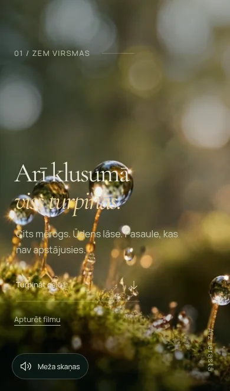
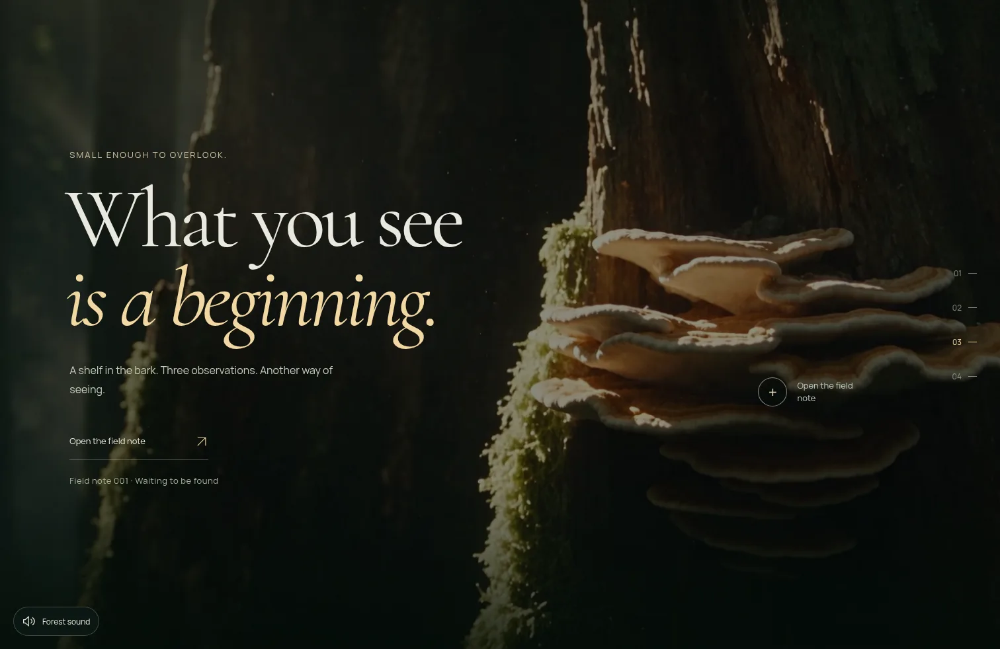
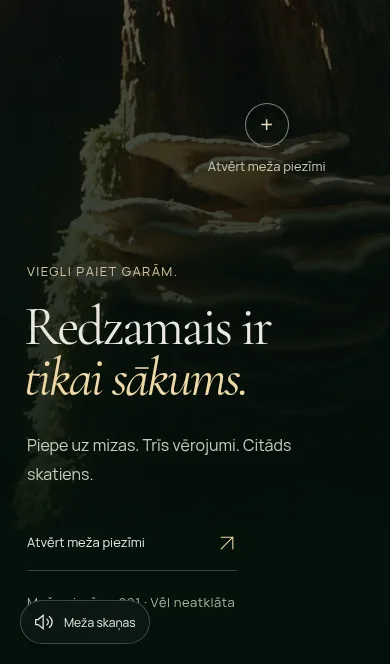

# PIE.PE 2.5.2 — shorter Understory scroll

Issue [#14](https://github.com/aigars-avotins/piepe/issues/14) was read completely, including its source audit and release boundary. The owner's task explicitly authorizes merge and deployment, superseding the older stop-before-merge instruction in the issue. Branch: `codex/piepe-v252-understory-scroll`.

## Verified base and diagnosis

Latest main is `37d3d13e3da7d2a04ea914447847b36de5c8af16`, the published **2.5.1** release. Cloudflare's successful main build `fd616ff2-808f-4873-a57f-1292137de925`, active Worker version `5918c013-a69b-4ff5-a65f-fb6bdfe98a7a` at 100%, and live HTML byte-identical to the fresh baseline build independently agree. No local changes were discarded.

The cause is native sticky geometry, **not a video-completion lock**. Understory occupied **280svh desktop / 300svh phone**, with its copy held in a 100dvh sticky viewport. Wheel/touch input continued changing `scrollY` while movie time advanced and looped, but the long stationary composition hid that progress. The Understory lifecycle does not cancel wheel/touch events or wait for `ended`; its only environmental completion behavior is replay. Body scroll locking belongs to the separate Awakening/dialog interaction, not Understory.

The fix adds two narrowly scoped `.bark-chapter.cinematic-chapter` overrides: **160svh desktop / 170svh phone**. They precede the existing static-preference override, so reduced-motion/save-data and no-JS visits retain **100svh**, with relative, non-sticky content. The 100dvh full-bleed film, photographic crop, text, film duration/quality and all existing camera timelines/thresholds are unchanged. The camera and macro envelope already derive their entrances/exits from actual section positions; they need no new timing or opacity workaround. Desktop's stationary travel shrinks from 180svh to 60svh; phone's from 200svh to 70svh.

Breathing is diagnostically long too (280/300svh), but already offers immediate return/wallpaper actions. **Its length is unchanged.** A separately approved follow-up could evaluate a similar 160/170svh budget; that is a proposal, not part of this fix.

## Actual distances

Clean Chromium contexts, production builds through the existing media Worker preview, font/layout readiness, both LV/EN. Start: Understory aligned with the viewport, all its copy readable and its film opaque. “Heading” means the first 48px of Encounter's heading are visible; “note” means its complete note button fits with 20px bottom clearance. These deliberately count the existing Encounter layout too. Values are pixels, before → after; ranges cover LV/EN.

| Viewport | Understory section | First Encounter heading | Usable note button |
| --- | --- | --- | --- |
| 1512×982 | 2750 → 1571 | 2285–2299 → 1106–1121 | 2666–2680 → 1488–1502 |
| 1440×900 | 2520 → 1440 | 2090–2104 → 1010–1024 | 2459–2474 → 1379–1394 |
| 390×844 | 2532 → 1435 | 2505 → 1408 | 2746 → 1649 |
| 390×664 | 1992 → 1129 | 1893 → 1030 | 2134 → 1271 |
| 320×690 | 2070 → 1173 | 1984 → 1087 | 2223 → 1326 |

Thus the next heading needs **1.12–1.14 additional viewport heights on desktop**, **1.55–1.67 on phones**, versus **2.32–2.34 / 2.85–2.97**. The whole note target needs **1.51–1.55 / 1.91–1.95**, versus **2.71–2.75 / 3.21–3.25**. The next chapter's label and photographic transition appear earlier. Phone heading placement remains slightly beyond the approximate 1–1.5-screen aspiration because the existing Encounter copy is intentionally low in the frame; moving that copy would expand this minimal fix. The travel reduction is **120svh desktop / 130svh phone**, without compressing the dissolve or changing composition.

[Complete measured geometry](qa/v252/scroll-geometry.json) includes positions, copy bounds, film opacity and overflow/snap state for every view/locale. Distances are scroll geometry, not claims about uniform real-world swipe size or wall-clock speed.

## Real browser evidence

Same scripted interactions, baseline 2.5.1 versus candidate 2.5.2. Desktop EN uses native wheel events; phone LV uses CDP touchstart/move/end with real browser scrolling. Initial positioning is explicit so recordings share a defined entrance and readable start. The recordings retain navigation/setup frames; initial blank browser navigation is not a loaded-film flash. QA MP4/WebP encoding changes only evidence, never product media.

| Input/view | Before | After |
| --- | --- | --- |
| 1512×982 EN, wheel | [Recording](qa/v252/before-desktop.mp4) | [Recording](qa/v252/after-desktop.mp4) |
| 390×664 LV, touch | [Recording](qa/v252/before-phone.mp4) | [Recording](qa/v252/after-phone.mp4) |

The note target becomes usable after **8 → 5 wheel actions** or **10 → 6 touch swipes** with the same nominal input sizes. [Input/time evidence](qa/v252/scroll-input-evidence.json) retains `defaultPrevented:false`, scroll positions and initial movie time. CPU/recording/screenshot overhead differs, so elapsed recording duration is not used as a performance benchmark.

| Stage | Desktop after | Phone after |
| --- | --- | --- |
| Entrance |  |  |
| Readable film |  |  |
| Exit |  |  |
| Encounter |  |  |

Chronological frames extracted at 2fps were visually reviewed in all four recordings. The existing forward camera/dissolve remains full bleed with readable copy, and the next scene arrives sooner. The exit was also inspected at the recording’s full 25fps cadence: 24 desktop frames and 44 phone frames. It remains a continuous existing dissolve, with no uncovered ground, borders or persistent duplicate scene. Release results are recorded below when complete.

## Focused verification

- The new geometry regression **fails on baseline 2.5.1** (2.80 rather than 1.60 viewport heights), then passes for all ten candidate viewport/locale combinations. It also checks full-screen `cover`, copy bounds, unchanged Breathing, no horizontal overflow, reduced motion, and phone height refresh (844 → 664).
- New interaction probes require actual presented/advancing movie frames, native forward/reverse input, looped playback, immediate exit while playing/paused/buffering/failed, offstage decoder cleanup, a usable note target, the existing continuation anchor and Back/Forward. No product event interception, scroll animation or waiting period is added.
- Existing repeatable-film tests now sample three separated positions within Understory's **actual shorter sticky region**, retaining every cadence, actual-pixel, cover, loop and three-revisit assertion. Breathing's sample positions are unchanged. An old fixed 140vh Understory offset would test its intended exit instead of its readable plateau.
- Initial development interaction failures were test harness issues: same-fragment navigation retained intentional pause, and releasing an already-cancelled buffered request tried to continue a handled route. Scenarios now use distinct document URLs, isolated contexts for unavailable media, and explicitly handle the expected cancelled request. Native Back/Forward additionally waits for the observed scroll endpoint to settle before the next traversal. No application code or assertions were relaxed to address these failures.

TypeScript, ESLint, production build and **11 Worker unit tests passed** locally. All **16 unique new Chromium scenarios passed across focused development batches** (10 geometry/static cases, four unavailable-media cases, two native journey/history cases). The single complete release validation will be added before merge. Production smoke now additionally asserts the short Understory geometry on the actual live page.

All four delivered MP4s remain **30,320,610 bytes**, with unchanged [SHA-256 checksums](qa/v252/media-integrity.json). No posters, source masters, other production assets, Worker/security/Cloudflare configuration, CI triggers, dependencies, SEO/i18n content, note state, sound preferences, cold-opening source selection, reversible camera ownership or photo handoff logic changes. No PIE.PE 3.0 work.

## Release validation and limitations

Pending final candidate validation and authorized publication. Native macOS WebKit is tested through the existing GitHub release workflow; this Linux executor cannot certify physical iPhone Safari. Phone resizing exercises viewport/layout refresh, not the real Safari toolbar. Save-data uses the existing Network Information emulation where supported. Release/production results will distinguish these limits explicitly.
