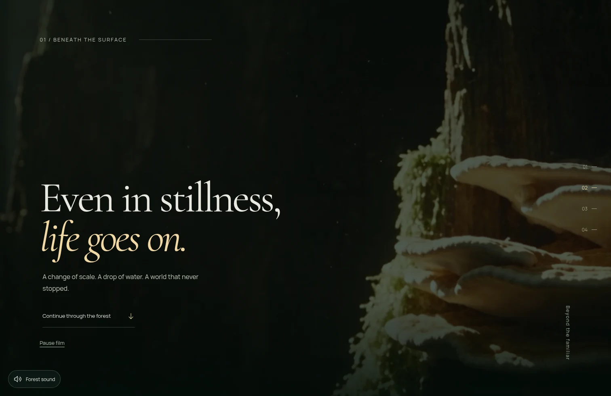
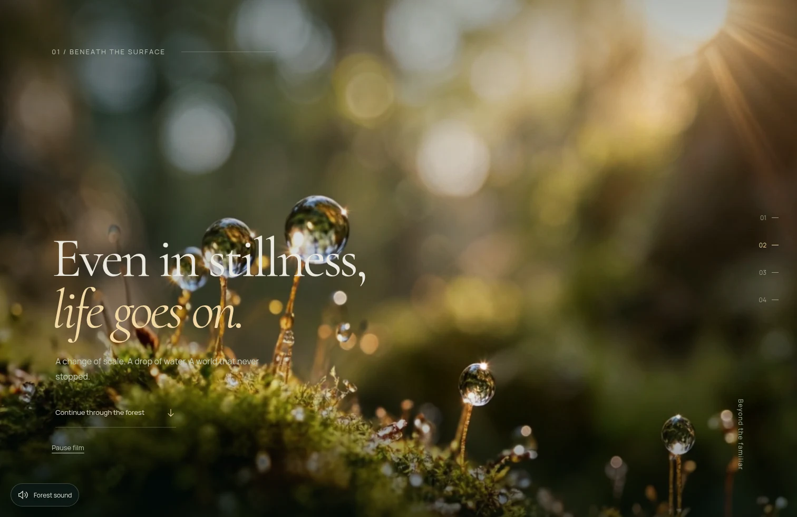
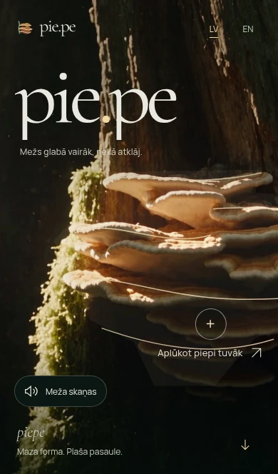
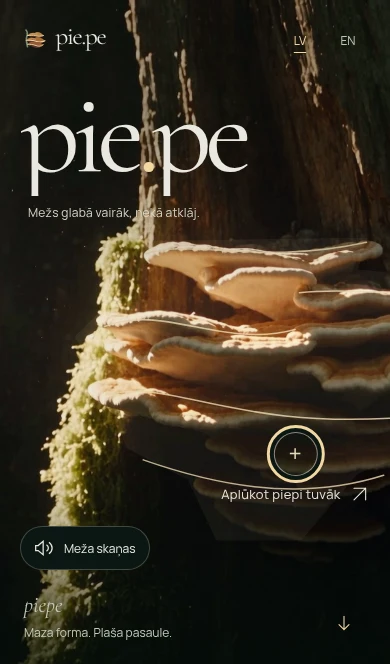

# PIE.PE 2.5.3 — stability candidate

## Baseline and release boundary

Main was fetched without discarding work and remains **`17bbb92af34fa610b4f28b825d59d1d2308a2b53`**, PIE.PE 2.5.2. Branch: `codex/piepe-v253-final-stability`. The complete owner-supplied 2.5.3 specification, V252/V251/initial QA, current cinema sources and all requested tests were read before implementation. Existing production remains the 2.5.2 Worker version `c747f44f-c2a4-4622-a058-de73872e3f24`. **No merge or production deployment is authorized for this candidate.**

## Historical WebKit investigation

The original full attempt [40904277665](https://github.com/aigars-avotins/piepe/actions/runs/40904277665) ran before the 2.5.2 preparation-clock fix: Chromium 135 pass; native macOS WebKit 130 pass / four fail / one expected recorder skip. Its reports, failure screenshots, traces and recorded reverse journey were retained locally and inspected alongside the later baseline/focused artifacts linked in V252-QA.

A new four-case [control on unchanged final 2.5.2](https://github.com/aigars-avotins/piepe/actions/runs/41092647428) ran natively on macOS: **two passed, two failed**, with actual AppKit foreground activation and no video recording in the cadence/clock probes. It does not count as a complete suite.

| Historical failure | Exact assertion and current evidence | Classification / action |
| --- | --- | --- |
| `cinema.spec.ts`, `1512x982 rendering / awakening final frame docks and returns continuously at 1512x982` | Escape must hide the native dialog within 2,000ms. The control reproduces the failure; Escape/cancel occurred at 14,481ms and restored opener focus at 16,512ms (2,031ms). The dialog is subsequently closed, source remains correct, and the native heartbeat reports a maximum 2,441ms render gap. | **Baseline native completion bound reproduced; product/environment contribution unresolved.** The real preparation-clock defect is already fixed in 2.5.2. No assertion or timeout is relaxed. The full candidate later passes both cinema docking scenarios; the passive follow-up also passes this unchanged photo path. This remains an intermittent native timing observation, not a claimed new photo fix. |
| `forest.spec.ts`, `actual film plays once, reveals title, ends and becomes interactive` | Historical `scrollY < 5` observed 5,025. The current test places the sticky Return action onstage and waits for observed native scroll settlement; current application is unchanged in this path. The new control passes zero scroll, `#forest`, focused hero and no intro replay. | **Corrected test setup race; current control passes.** Keep production Return behavior. |
| `v23.spec.ts`, desktop LV `visible moving frames across broad plateaus, three revisits, loops and reload` | Historical Breathing readiness remained false and hit existing `load-timeout` with readyState 0. In the new control this long test instead fails earlier at Understory cadence: one presented callback within 2.5s while time advances to 4.74s, readyState 4 and 145 decoded frames; maximum native heartbeat gap 3,022ms. | **Original load-timeout cause remains inconclusive; new native cadence failure is retained.** It is not evidence of unchanged pixels or proof that all decode failures are harmless. A separately reproduced first-presentation lifecycle defect is fixed below; it is not claimed to explain historical readyState 0. |
| `v251.spec.ts`, `2.5.1 reverse 390x664 / lv: bottom to top stays a single forest after refresh and three native returns` | All three original bottom/top/refresh returns already reached identity camera and zero ghost contribution; a later Return action remained at scroll 4,530. The new unchanged-2.5.2 control passes the entire scenario. | **Not reproduced in current control; original later input/scroll observation remains inconclusive.** No ghost-layer reset or Return rewrite is justified. |

The native failures are not hidden behind later successful smoke or retries. A local Chromium result cannot certify Safari hardware. [Passive lifecycle follow-up 41095420988](https://github.com/aigars-avotins/piepe/actions/runs/41095420988) passed the unchanged photo probe and both new staging cases; its two new keyboard tests failed at the default Tab assumption. Photo return prepared for 39ms and completed/restored focus in **1,098ms** after Escape, despite a 2,030ms maximum heartbeat gap elsewhere in that test. This does not erase the earlier 2,031ms failure or establish a separate camera fix. A subsequent keyboard-only attempt [41096529379](https://github.com/aigars-avotins/piepe/actions/runs/41096529379) still skipped links after initialization; no product tabindex changes are justified. The initial candidate dispatch [41094932848](https://github.com/aigars-avotins/piepe/actions/runs/41094932848) stopped at a test-file ESLint aliasing error, before any native test ran; that was corrected without assertion changes.

[Precise historical/control assertions and passive observations](qa/v253/historical-reproduction.json). The final candidate results and their limits are recorded below.

## Confirmed changes

- **Environmental first presentation:** readiness previously depended on a presented-frame callback while both the video and, with a pending poster, its containing clip could be fully transparent. A compositor that withholds callbacks for invisible video cannot break that cycle. Deterministic tests preserve actual decoding/callbacks/pixels and reproduce the deadlock in both films on 2.5.2. Stage only a decoded frame (`readyState >= 2`) and its clip; actual presentation still owns ready state. No readiness timer, synthetic frame, media downgrade or new dependency. Existing replay canvas, watchdog, visibility handling and retry controls remain.
- **Keyboard focus:** the irregular hit polygon clips a conventional outline; its former six-percent wash leaves no clear persistent focus marker. Highlight the existing adjacent invitation circle only while the hit target matches `:focus-visible`, using the approved gold and dark backing. No hit geometry, pointer UI, new control or native dialog/focus-restoration changes.
- **Version only:** package/root markers advance to 2.5.3. Production changes are limited to environmental staging and the keyboard focus marker above. Intro, photo clock, Return navigation, content, geometry and resource priorities are retained.

The focused marker and invisible-compositor regressions fail on 2.5.2 and pass with these fixes. An initial new assertion requiring a conditional cold preload belonged to the rejected performance experiment below; it is not classified as a product bug or retained as a requirement. New keyboard traversal initially assumed native modal focus could never enter browser chrome; actual Chromium reports BODY with `document.hasFocus() === false` at the tab boundary. The test now permits only that native chrome transition or an element inside the dialog, never a background interactive control. No custom focus trap is added. The subsequent focused four keyboard/staging cases pass locally. Native keyboard attempts first raced hydration and then exposed Safari’s default Tab-to-links setting. The final keyboard test awaits initialization, uses a desktop profile and Safari’s native Option+Tab all-control traversal, while preserving the same focus/outline/modal assertions. Replay already hides under static preferences (`.static-preference .replay-intro`); a redundant disabled-attribute experiment was removed after this was verified.

## Security / SEO audit

Both live localized HTTPS responses contain **exactly one HSTS policy: `max-age=2592000` (30 days)**, without `includeSubDomains` or `preload`. Cloudflare applies it correctly; no HSTS or unrelated security configuration is changed. Existing CSP, DENY framing, nosniff and restricted Permissions-Policy are present. Boot script hashes continue to be generated by the existing prerender build. Both actual live localized HTML documents match the candidate’s complete metadata, canonical/hreflang and single JSON-LD. Live robots/sitemap match source bytes and list exactly LV/EN. All four films return HTTP 206 with exactly 64 requested bytes. [Live audit](qa/v253/live-sanity.json). Existing regression suites additionally check candidate schema/CSP hashes and media errors. No SEO rewrite is needed.

## First-load performance audit

The existing high-priority `forest-final.jpg` preload is useful for return/static visitors. A first cinematic visit also gets a **high-priority opening-poster hint from React’s server-rendered image resource hints**. It is not waiting for hydration to discover that poster. Both images are reused by existing layers; this is an intentional static/final dependency, not duplicate byte transfer of the same URL.

A trial selected the opening/final hint in boot and lowered hidden-image priority. Twenty configurations per build covered **desktop 1512×982 / phone 390×664 × LV/EN × first, session-return with cold cache, reduced, save-data and warmed return**. Each configuration used a fresh Chromium process, production dist and the real media Worker; 100ms emulated latency, 750,000 B/s download, no CPU throttle. Warmed returns use the observed public media/asset cache policies, with final-image requests transferring zero encoded bytes. Fixed observation windows: 8.5s after DCL for cinematic first visits, 2.5s for static visits. Ongoing media bytes are included separately from completed resources. These are lab observations, not field metrics or a statistical speed claim.

| First visit | Opening response end, baseline → trial | First presented video callback, baseline → trial |
| --- | --- | --- |
| Desktop LV | 3,247 → 3,211ms | 3,850 → 3,848ms |
| Desktop EN | 3,207 → 3,175ms | 3,883 → 3,818ms |
| Phone LV | 3,170 → 3,281ms | 3,859 → 3,838ms |
| Phone EN | 3,156 → 3,244ms | 3,826 → 3,830ms |

**Reject the trial.** Video start shows no consistent useful improvement and both phone poster responses regress. `index.html`, `boot.js`, `ForestScene.tsx` and the monitor priority therefore retain their original implementation. No first-load speedup, byte savings or Lighthouse improvement is claimed. A second preserved-priority matrix retained an outlier, and the final exact application build was measured too. The latter completed fourteen configurations before a local warm-navigation DCL timeout at the unchanged 30-second bound; only its remaining six configurations were then measured. These are twenty completed lab measurements across two attempts, not a one-shot successful browser suite. The local navigation interruptions remain inconclusive; these measurements do not certify navigation reliability. All static cases retain zero movie elements. No observation is removed to improve the reported range.

| Final candidate, LV/EN × both sizes | LCP | FCP | Received bytes in the fixed window | Maximum CLS |
| --- | --- | --- | --- | --- |
| Cold first visit | 672–724ms | 672–720ms | 7,592,480–8,147,175 | 0 |
| Cold-cache session return | 640–740ms | 640–740ms | 3,109,588–3,109,729 | 0.00296 |
| Reduced motion | 632–704ms | 632–704ms | 3,259,592–3,259,733 | 0.00410 |
| Save-data | 644–1,172ms | 644–1,172ms | 3,259,592–3,259,733 | 0.00328 |
| Warmed session return | 188–332ms | 188–332ms | 941,266–1,086,617 | 0.00016 |

First presented video callback is **3,813–4,569ms** on the final build versus **3,826–3,883ms** in the baseline sample. The slower sample is retained; this single-sample, locally throttled matrix cannot establish a causal slowdown or speedup. Original media/priority remain, so no timing change is shipped to chase those values. Fixed-window transfer variation also reflects ongoing high-fidelity movie buffering and later stills, not a lower-quality asset. [Final raw measurements and exact build hashes](qa/v253/performance-release.json).

[Raw baseline waterfalls/LCP/FCP/pixels/bytes](qa/v253/performance-baseline.json), [rejected trial](qa/v253/performance-rejected-priority.json), [paired comparison and explicit decision](qa/v253/performance-comparison.json). Chrome’s cinematic LCP candidates are small brand/sound elements, not the full forest presentation; static LCP is usually the wordmark span. Actual poster completion and first presented/advancing movie times are therefore reported independently. CLS is retained in the raw observations, rather than inferred from screenshots. Early benchmark attempts with a reused browser timed out on navigation; those partial attempts are discarded and do not count toward the twenty-case matrices.

## Actual visual and accessibility evidence

The compositor/pending-poster condition is deliberately injected, while browser decoding, time, pixel hashes and recordings remain real. It is not claimed to be a recording of the historical readyState-0 timeout. Before, both films advance but remain effectively **opacity 0 / not ready**; after, both are **opacity 1 / ready**, with three distinct decoded pixel hashes and advancing time. The pending poster does not need to finish to expose decoded movie pixels. [Complete samples](qa/v253/staging-evidence.json).

| Scenario | Before 2.5.2 | After 2.5.3 |
| --- | --- | --- |
| Desktop EN Understory | [Recording](qa/v253/before-understory.mp4) | [Recording](qa/v253/after-understory.mp4) |
| Phone LV Breathing | [Recording](qa/v253/before-breathing.mp4) | [Recording](qa/v253/after-breathing.mp4) |
| Desktop EN film |  |  |
| Phone LV keyboard marker |  |  |

All four recordings were reviewed chronologically at 2fps, including entrance and continuous scene motion. Both candidate entrances were additionally inspected frame by frame at 25fps through the first 1.6 seconds; the phone frame at 1.36 seconds was checked at full resolution to distinguish contact-sheet resampling from actual ghosting. The original blank browser navigation, when present, precedes loaded content; it is not a loaded-poster flash. The candidate retains full bleed and the existing camera/dissolve; no black intermediary is introduced. QA MP4/WebP encoding affects evidence only. Focus was also captured on both locales and desktop/phone ([computed marker states](qa/v253/accessibility-focus.json)); the gold ring has a dark backing and only appears for keyboard focus on the existing clipped hit target.

Native dialog behavior, focus restoration, observation tabs, audio and language/download controls are preserved. The new keyboard journey checks the actual focus marker, modal background exclusion, note download and control focus. A native browser-chrome tab boundary is allowed only when BODY is active and the document has lost focus; background interactive elements remain forbidden. New visibility-event coverage observes real pause and three actual resumed frame timestamps in each environmental film; the visibility event is emulated, not claimed as physical Safari tab certification.

## Final validation and unresolved native observation

Typecheck, ESLint, all **11 Worker unit tests** and production build pass. Delivery lint/typecheck also pass after the final diagnostic-helper cleanup. Focused Chromium: **16/16** paint/staging/clock cases, then **6/6** final keyboard/static-preference cases, plus **1/1** actual-frame visibility pause/resume.

The single planned complete [release attempt 41098371858](https://github.com/aigars-avotins/piepe/actions/runs/41098371858) used application candidate **`cfefac9b745fcf78b848210428d0974347bb16a2`**, 152 scenarios per browser, actual production dist and the existing media Worker. All **57 Chromium CI build files match the locally measured final application build byte for byte**. Later commits change only test observers, diagnostics, CI budget and documentation; production source and build inputs are unchanged.

| Validation | Actual result | Interpretation |
| --- | --- | --- |
| Full Chromium, Linux | **152/152 pass**, no skip/failure/flaky outcome; 866.2s | Successful complete Chromium suite, LV/EN and desktop/phone scenarios included. |
| Full native WebKit, macOS 15 Intel | **143 pass, 2 fail, 1 expected CDP-recorder skip, 6 unfinished** | Job reached its 20-minute cap. These counts come from the finalized job log; the interrupted JSON reporter did not produce `results.json`. **Not a successful full suite.** |
| [Focused native completion/diagnosis 41103135854](https://github.com/aigars-avotins/piepe/actions/runs/41103135854) | **11 pass, 1 fail**, 162.6s | All six unfinished native journeys, both corrected photo-clock cases, both native keyboard locales and the extra pending-decode Escape case pass. Desktop LV repeatable-film cadence still fails. |
| [Single-case native host diagnostic 41106976080](https://github.com/aigars-avotins/piepe/actions/runs/41106976080) | **1/1 pass**, 54.6s | The same desktop LV journey passes in isolation without a product change. This establishes intermittency, not a fix or successful unfiltered release suite. |

All **15 new 2.5.3 native scenarios pass in the full attempt**. Both original cinema docking sizes, all four stable-photo locale/size scenarios, all cold-opening and reverse/three-return cases, and all ten shortened-geometry checks also pass. The focused completion verifies native exits while playing, paused, looping, genuinely buffering or errored; anchors/history remain usable. Full/focused reports and raw failure evidence are linked in [release-validation.json](qa/v253/release-validation.json) and [native-full-attempt.json](qa/v253/native-full-attempt.json).

**Photo-clock observer correction:** one full native failure assumed the first positive rAF sample was the first moving frame. It observed aperture ratio 0.923347 at progress 0.134477, corresponding to approximately 47ms of the correct one-second trajectory. The revised observer keeps the zero-progress aperture above 94% and more than ten moving poses, then compares every moving rectangle with actual elapsed time and the existing ease, allowing only one 60Hz frame of clock quantization. Escape's two-second bound and focus restoration remain. A negative control on the pre-fix 2.5.1 snapshot **fails both sizes**, detecting 250.7/248.9ms of leaked preparation time; current Chromium **2/2** and native **2/2** pass. This corrects a demonstrably invalid sampling assumption; it does not weaken a deadline or change product camera code. [Negative/current control evidence](qa/v253/clock-observer-validation.json).

**Remaining intermittent native film observation — release blocker:** the long desktop LV repeatable-film case hits `load-timeout` with readyState 0 on a later decoder in the full attempt. In focused diagnosis it reaches readyState 4, loops and decodes 290 frames but yields only **two advancing presentation callbacks in 2.5 seconds**, below the unchanged six-callback requirement. The native page is visible and foreground, its full 6.042-second buffer is present, MP4 range responses are valid 206 and the resumed transfer finishes. The maximum rAF gap is **2,905ms**. AVFoundation's cancelled initial broad request followed by a completed byte-range resume does not establish a transport defect; neither does decoded-frame count prove smooth onscreen presentation. [Passive transport, timing and failure evidence](qa/v253/native-remaining-failure.json).

The final single-case pass reports maximum rAF gap **879ms** and actual macOS display **1920×1080**, usable area 1920×970, scale 1, foreground Playwright. WindowServer bounds could not be obtained through the selected JXA binding, so window occlusion is not excluded. The failed optional window query was removed from the final helper; reliable NSScreen capture is retained. [Host diagnostic](qa/v253/native-isolated-display.json). We cannot yet separate a real Safari playback/cadence issue from native runner/compositor scheduling, and this failure has not been reproduced in the live Safari application or on a physical iPhone. **It must not be dismissed as a harmless CI artifact.**

Across attempts, 151 distinct native scenarios have passed and one expected recorder skip remains. That coverage **does not replace an unfiltered successful native suite** or erase the repeated failure. No second full browser suite was launched. The native job budget is raised from 20 to 25 minutes for a future approved release validation because setup plus the suite exhausted the job cap; no individual assertion timeout changes. Existing economical automatic checks, manual-only expensive suites, release concurrency protection, security/media tests and production smoke options remain.

Native cold-opening recordings were sampled across both locales and desktop/phone: [12-frame first-presentation matrix](qa/v253/native-openings.webp). It shows the intended wide opening, with no preceding close-up fungus. Actual native focus screenshots also confirm the existing invitation marker in [LV](qa/v253/native-focus-lv.webp) and [EN](qa/v253/native-focus-en.webp). Both native 390×664 reverse/three-return recordings (LV and EN, approximately 27 seconds each) were also inspected chronologically at one-second intervals: settled returns show a single hero, while the existing layered camera/dissolve is confined to transitions. These rendered observations supplement assertions; they are not hardware certification. Full native recordings/traces remain in the linked run artifacts, retained by CI for 14 days; concise first-paint/focus evidence is committed here.

All four high-fidelity film files, posters, source masters, wallpapers and brand assets remain untouched. Understory stays 160svh desktop / 170svh phone / 100svh static; Breathing's length is unchanged. No content, camera timeline, scroll activation geometry, native dialog implementation, framework or dependency changes. No PIE.PE 3.0 work.

## Physical iPhone Safari checklist

Not executed in this Linux cloud executor or the macOS WebKit emulated-phone runner:

- Fresh private LV/EN visit on Wi-Fi and a slower cellular link; inspect first poster, film and skip.
- Touch Understory/Breathing forward/back three times; confirm motion, full bleed, loops and immediate natural exit.
- Collapse/expand the Safari toolbar, rotate at the ending, then return to a single hero.
- Open/close discovery, reverse mid-move, use tabs/downloads and confirm focus with an external keyboard/VoiceOver.
- Background/foreground the tab; try Reduce Motion and unavailable/blocked media.

## Readiness and rollback

**Ready for code/visual review; not ready for production. Do not merge or deploy.** The two small fixes have deterministic before/after evidence and their focused native regressions pass, but the intermittent native load/cadence failure remains a release blocker until its cause or real Safari impact is established. No physical iPhone, Safari-app, VoiceOver or hardware data-saving certification was performed; visibility/save-data events are emulated where stated. The native viewport is not a physical device.

Regression risks are limited to decoded-video staging timing and the keyboard-only marker, plus the unresolved native film issue. Existing media failures continue through the unchanged watchdog/fallback controls. No arbitrary first-frame wait, synthetic readiness, assertion removal or individual deadline increase is shipped.

Production remains **2.5.2**, confirmed by the [existing Worker deployment record](qa/v253/release-boundary.json). Cloudflare's branch-preview build separately fails its existing Worker-name guard after building the application; [exact message](qa/v253/branch-preview-guard.json). This does not publish the candidate. No Worker was renamed or created, and there is no deployed 2.5.3 preview to certify. Main is still the verified 2.5.2 SHA.

If a later approved deployment requires rollback, restore existing Worker version **`c747f44f-c2a4-4622-a058-de73872e3f24`** from `piepe` deployment history and recheck LV/EN HTML, media ranges and the cinematic journey. Keep the domain and Cloudflare security settings; no new Worker or Pages project is needed.

## Public-repository security review and final native validation

The repository is now public. [Credential review](V253-SECURITY-REVIEW.md) covers the reachable Git history, expanded historical QA reports and all 133 available Actions log archives. No confirmed exposed credential or immediate rotation finding was identified; two log candidates are public browser analytics identifiers. GitHub's own secret-scanning API returned 403, so its status remains unverified. The review's exact scope and exclusions are recorded separately.

The owner now authorizes necessary standard Ubuntu/macOS validation, without paid larger runners. One final native-only full validation will use the existing standard `macos-15-intel` job with its 25-minute job budget and corrected clock observer. Chromium's complete 152/152 result is retained; the application/media/build inputs have not changed. No merge, deployment, concurrency change or Cloudflare integration change is authorized. Final native outcomes will be appended here without replacing the earlier failure history.
