# PIE.PE 3.3 — what changed and why

Scope: the [3.3 Awwwards readiness brief](V330-AWWWARDS-TASK.md). Baseline: production 3.2.0 (`0b10d28`). Not deployed; the owner deploys with `npm run deploy` after review. Test results and limits are in [V330-QA](V330-QA.md); the submission material is in [V330-AWWWARDS-SUBMISSION](V330-AWWWARDS-SUBMISSION.md).

The creative stance of [3.2](V320-AWWWARD-CANDIDATE.md) is unchanged: restraint, native scrolling, no scroll hijack, no WebGL or particle engine, no new framework, the film never pauses for a lesson, sound is never required. No film was regenerated, re-encoded or replaced; every published film and matched frame keeps its hash.

## The audit that shaped the work

All real pages were captured at 390×844, 768×1024, 1440×900 and 2560×1080 in both languages before anything changed (118 screenshots; a selection is in `docs/qa/v330/before/`). What they showed:

- The cinema and the reading pages were each well made but did not read as one site. Reading pages had a mark and a language switch and nothing else; the home page had no way to the reading pages except links deep in the scroll; the home footer was a mark and a pause button.
- On phones the fixed sound pill sat on top of body copy and links in every chapter after the hero.
- There was no page explaining what the site is, how it was made or who made what — the first thing a juror or a curious visitor looks for.
- Every page shared one social image, the sitemap was hand-maintained without dates, and the films had no text equivalent.

## Phase 1 — defects (all sixteen audit items)

| # | Defect | What 3.3 does |
|---|---|---|
| 1 | A hidden tab during buffering latched "Play film again" | The `AbortError` from the component's own `pause()` is ignored (`EnvironmentalFilm.tsx`). |
| 2 | A missing intro film was only caught by the 4 s watchdog | The `<source>` error is heard directly (`IntroFilm.tsx`). |
| 3 | The image fallback always requested a file that never existed | The slot now points at the real 960 px serving copy, is skipped if that copy just failed, and counts as the real picture. |
| 4 | The atlas loupe and lightbox downloaded about 10 MB of originals | The loupe uses the smallest covering copy; the lightbox loads one original (the chosen surface) and sized, lazy copies for the two comparison views. |
| 5 | The portal opened with a 2.9 MB PNG; the quiet world used a 1.9 MB duplicate | Sized AVIF/WebP stills (213 KB and 199 KB at full size); the PNG and the native first frame remain as fallbacks; one URL instead of two identical files. |
| 6 | About 65 MB of unplayed files were published | The six masters moved to `source/portal/`, `forest-mobile.webp` to `source/legacy/` (bytes unchanged, manifests updated); `field-note.txt`, the 1-byte `aaaa` and the duplicate still are gone. |
| 7 | First paint fetched frames it did not show | No unconditional preload. The boot script preloads the one frame this visit paints; CSS paints it before React supplies the image; the two invisible plates wait until the opening is over. |
| 8 | Stale, inconsistent cache-busters | One `mediaVersion` in `src/release.ts` feeds TypeScript, CSS and HTML; portal media goes through `mediaUrl`; the stray `?v=2.2` is gone. |
| 9 | `404-page` configured, no page built | Designed bilingual `404.html`, now with the shared menu and the small light. |
| 10 | CSP hashed every JSON-LD block | Only the executable boot script is hashed: the line is 290 characters instead of 1,369 and no longer grows. |
| 11 | The build rewrote tracked field notes | The build writes `dist/` only; a test snapshot guards the wording. |
| 12 | Toggles announced state twice | One mechanism: the label carries the state. |
| 13 | Hard-coded "Aplūkot tuvāk", two tab stops for one action | Typed copy that matches the accessible name; the photographic hit area is pointer-only. |
| 14 | Unused copy keys and `snapshot()` | Removed. |
| 15 | README described 2.3 | Rewritten for 3.3. |
| 16 | `scroll-recording.spec.ts` failed locally | It skips cleanly without the live site or Playwright's ffmpeg. |

Two further defects surfaced while fixing these: the test helpers assumed any Mac was running the WebKit project (every Chromium test failed locally on macOS), and five generations of hash-preservation tests could not express an intentional change. Both are fixed; the second with one reviewed ledger, `docs/qa/v330/reviewed-sources.json`, that lists what 3.3 changed, moved or retired.

## Phase 2 — polish, by jury criterion

### Design (40%)

- **One site, not an experience plus a blog.** The same menu, footer and light now frame the cinema, all reading pages, the About page, the 404 page and the portal. The footer is designed to the hero's standard: the closing thought at display size, three short lists, the honest note about the imagery, the mark and the edition.
- **Typographic rhythm on reading pages.** Balanced headings, `text-wrap: pretty` paragraphs, kerning and ligatures on, hanging punctuation where supported. Cormorant Garamond carries every heading and Manrope every label and paragraph, on both sides of the site. Latvian diacritics were checked in headings, the footer and the generated social images.
- **Micro-interactions.** Every control now has hover, focus-visible and pressed states. Arrows on cards and return links move a few pixels in the direction they point; underlines warm to the accent. All hover effects sit behind `(hover: hover) and (pointer: fine)`.
- **Page-to-page transitions.** Cross-document View Transitions: the mark and the menu pill persist while the page dissolves. Browsers without support navigate normally; reduced motion disables it.
- **A deliberate first-load moment.** Before the opening frame arrives there is a single warm point of light where the fungus will be. The frame paints over it, so it masks media readiness without delaying anything, and it needs no script.
- **No custom cursor.** It was considered and rejected by the restraint test: the fungus and every control already change the system pointer, and a custom cursor would add a permanent animated layer over the films.

### Usability (30%)

- **Navigation from anywhere.** "Takas / Trails" is a native `
` menu fixed at the lower right on every page and in the portal's top bar: five destinations and both languages. It works without JavaScript; a small script adds Escape, outside-press and focus-out closing.
- **The phone sound pill no longer covers text.** After the hero it shrinks to its icon.
- **First-visit clarity.** The hero keeps its three signals (the labelled invitation on the fungus, "Enter the fungus" with its six-film hint, the scroll cue); the invitation is now a single tab stop whose visible text matches its accessible name.
- **A text equivalent for the films.** "The films in words" on the About page describes all ten films; the portal links to it.
- **Lighter pages.** The portal (player, thread, styles) is a separate chunk loaded on intent or once the opening has settled; React and GSAP are stable vendor files. The entry script is 116 KB (38 KB gzipped) instead of 459 KB (155 KB) in one file. Study photographs gain AVIF copies four to five times smaller than the WebP ones.
- **Alternative considered:** a conventional header navigation bar. Rejected for the cinema, where the header scrolls away and a row of links would sit on the film; one pill that behaves identically everywhere was preferred.

### Creativity (20%)

The one idea — attention as a small, movable light — now recurs instead of being joined by new effects: the first-light point on load, the light that follows a fine pointer on reading pages and the 404 page, the glowing dot in the menu pill, and the glow that arrives beside a hovered or focused link in the menu and footer. The portal's own movable light is untouched. Sound: the ambience graph and its portal transitions are unchanged; they were reviewed in code only. Nobody listened to the transition into and out of the portal for this release; that is on the owner checklist.

### Content (10%)

- **About / Colophon** at `/par-pie-pe/` and `/en/about/`: the idea, how it is made, the films in words, what is real and what is imagined, the wallpapers, access, tools, type and sound. The Latvian is written as its own text, not translated line by line.
- **Credits and contact are deliberately empty.** `colophonPeople` in `src/siteCopy.ts` renders a "Credits and contact" section as soon as the owner fills it in; no name or address was invented.
- Remaining visible strings that were hard-coded in components now live in the typed copy modules.

### SEO and sharing

- `src/routes.ts` is the single route table. The sitemap (with `lastmod`) is generated from it; the tracked `public/sitemap.xml` is gone.
- A 1200×630 social image per route and language, generated at build time in the site's own typefaces (`dist/og/`).
- Structured data: `WebSite` and dated `WebPage` everywhere; `Article` with `datePublished`/`dateModified` on the guide, the notes and the About page; `BreadcrumbList` on notes (already present); `ImageObject` with licence, credit and AI-made source type on wallpapers; `VideoObject` for the ten films on the home page.
- Web manifest: description, language, scope, a maskable icon and two screenshots.
- Headers: `Cross-Origin-Opener-Policy` and `Cross-Origin-Resource-Policy` added (social images opt out so other sites can embed them). `Strict-Transport-Security` was **not** added: production already sends it from the Cloudflare zone (`max-age=2592000`), and a second copy would duplicate the header. Raising it to one year is a zone setting for the owner.

## Deliberately left alone

- **The films and their matched frames.** The hero stills stay JPEG frames cut from the films; converting them was not worth the risk to frame continuity.
- **Fresh-visit LCP.** The largest element is still the wordmark that appears after the opening film. Making it paint earlier would mean showing the title over the film or shortening the film; neither is a performance fix. See QA for the measured numbers.
- **GSAP stays in the first load** (as a separate cacheable file): the scroll camera and the photograph handoff use it from the first interaction, and their timing is covered by strict tests.
- **The field-note dialog stays in the main chunk:** it is part of the server-rendered HTML that search engines read.
- **"Tapetes" and "foni"** are both still used for wallpapers in Latvian; the existing page copy is pinned by content tests and was not rewritten. The menu and footer use "Meža foni", matching the address.

## Before and after

Pairs are in `docs/qa/v330/before/` and `docs/qa/v330/after/` with the same file names.

| View | Before | After |
|---|---|---|
| Home, end of page, 1440×900 | 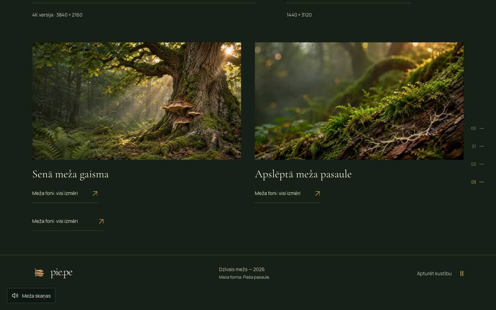 | 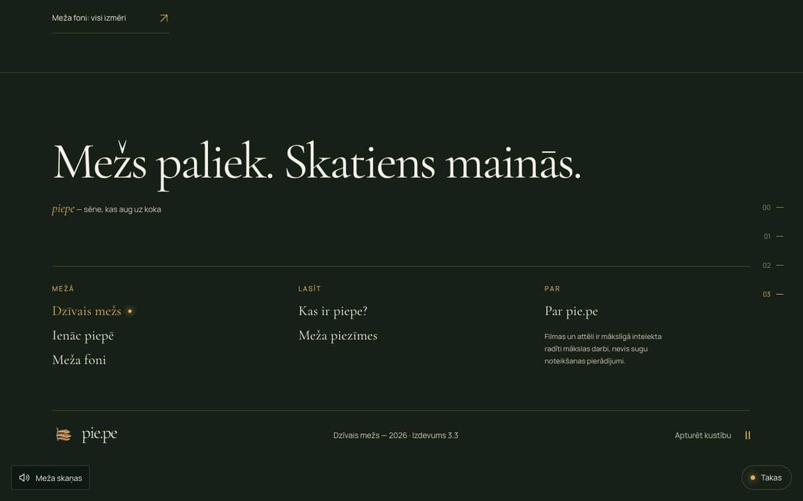 |
| Home, end of page, 390×844 | 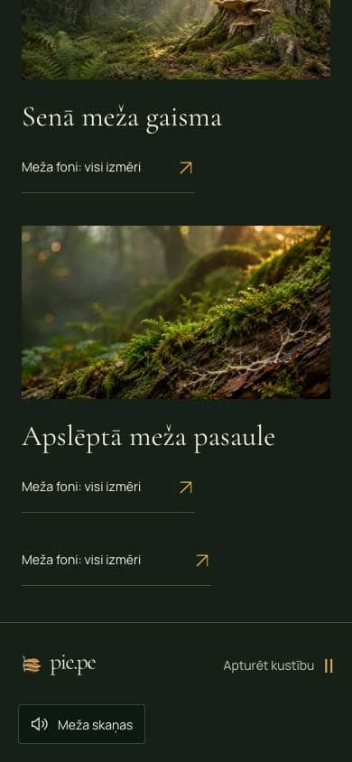 | 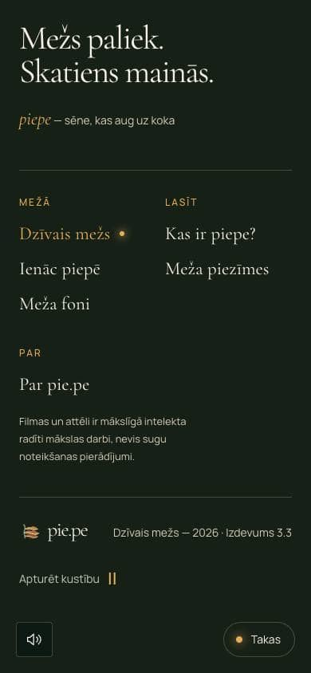 |
| Encounter on a phone (sound pill) | 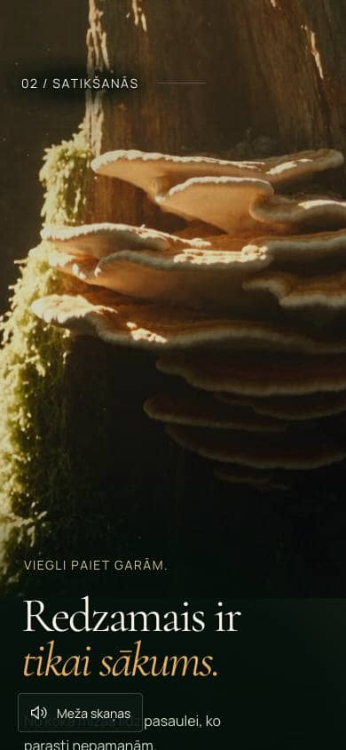 | 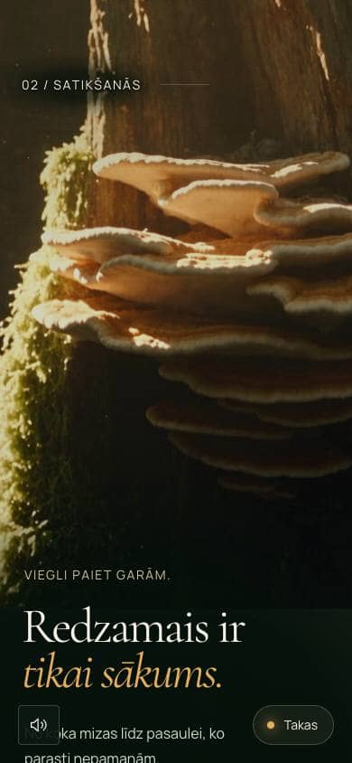 |
| Field note 003, end, 1440×900 | 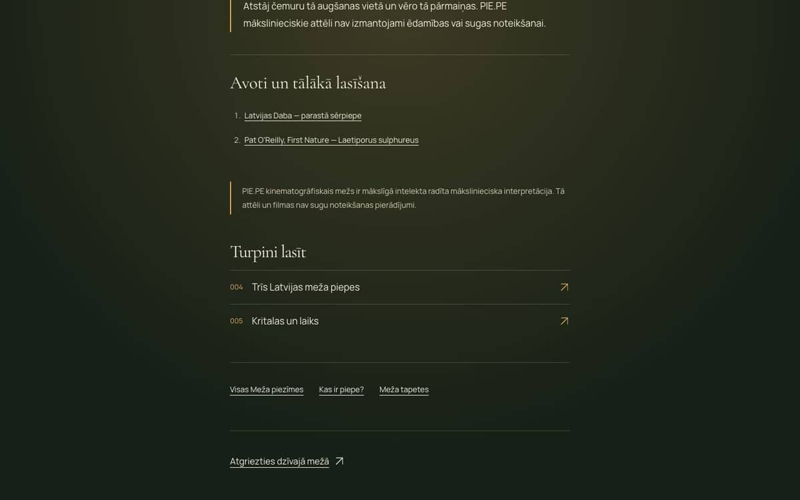 | 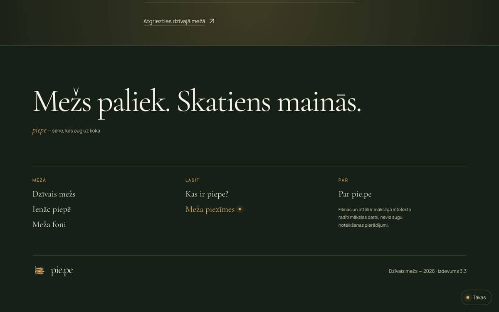 |
| Guide, 390×844 | 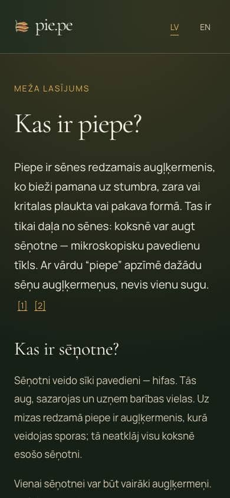 | 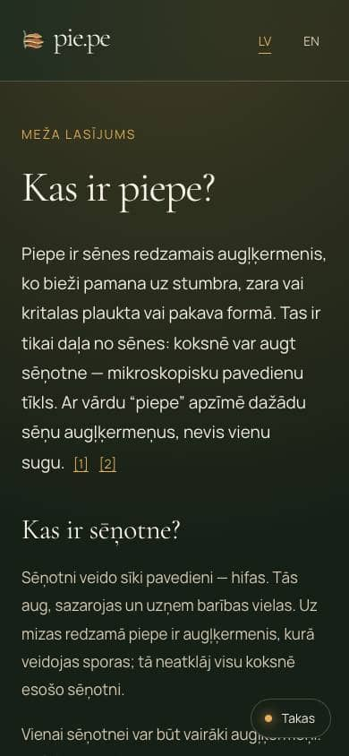 |
| Portal threshold, 390×844 | 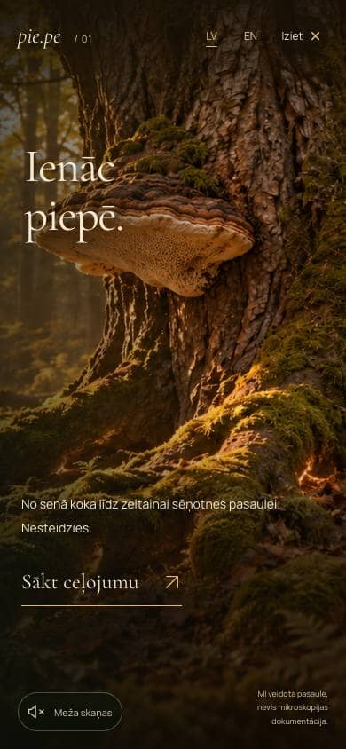 | 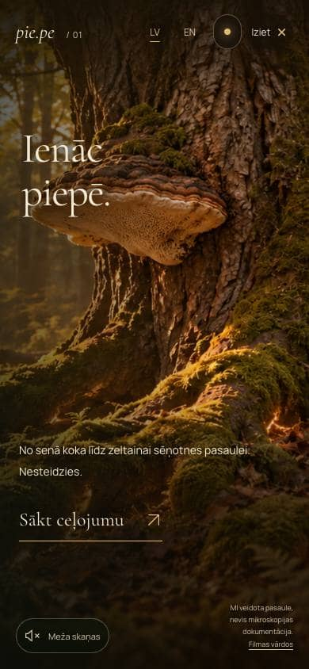 |
| Hero, 1440×900 |  | 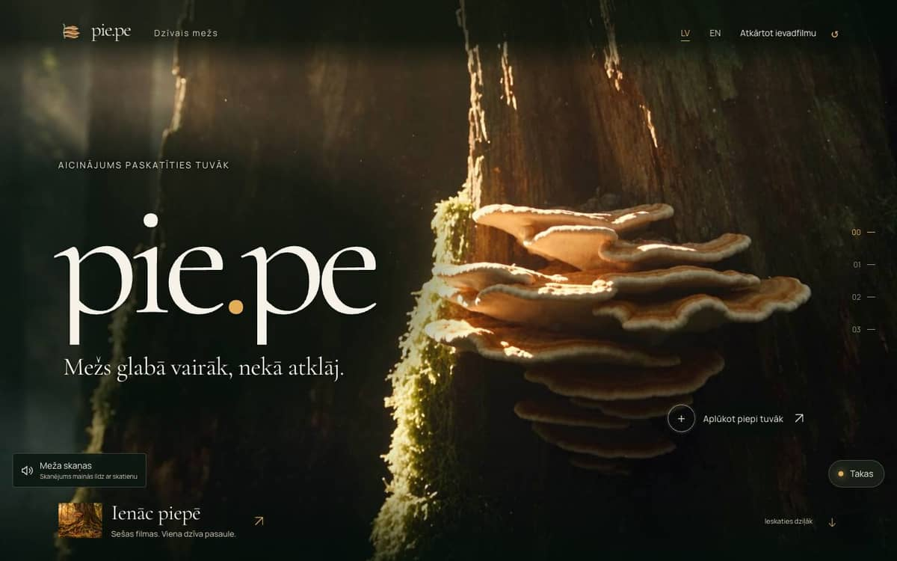 |
| About page (new) | — | 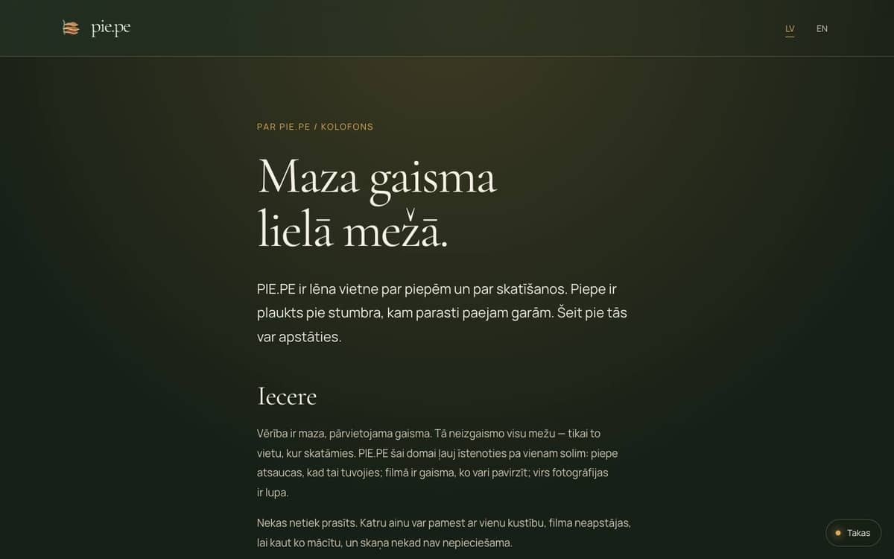 |
| Menu open (new) | — | 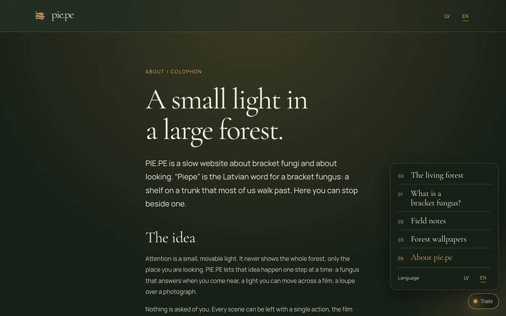 |
